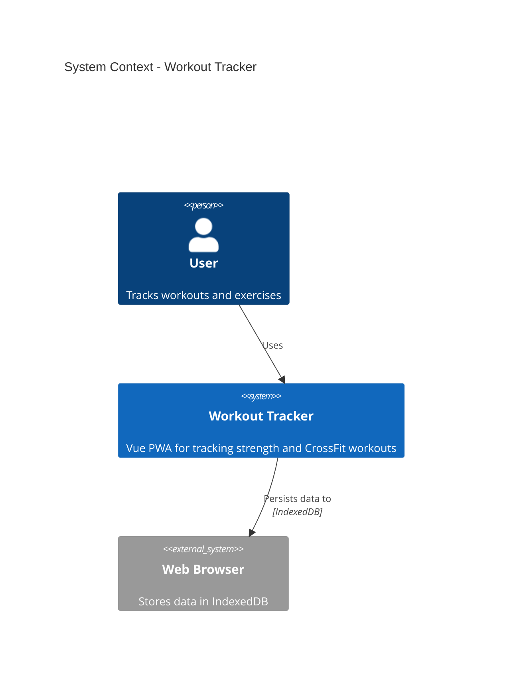
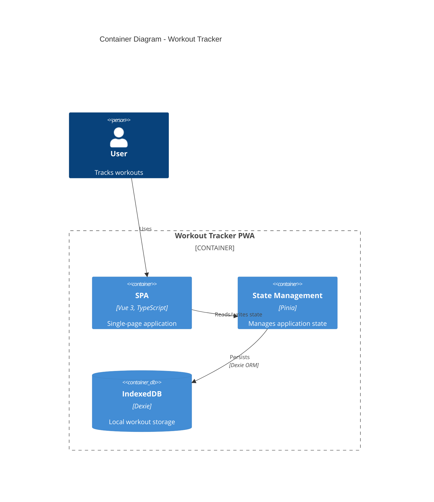
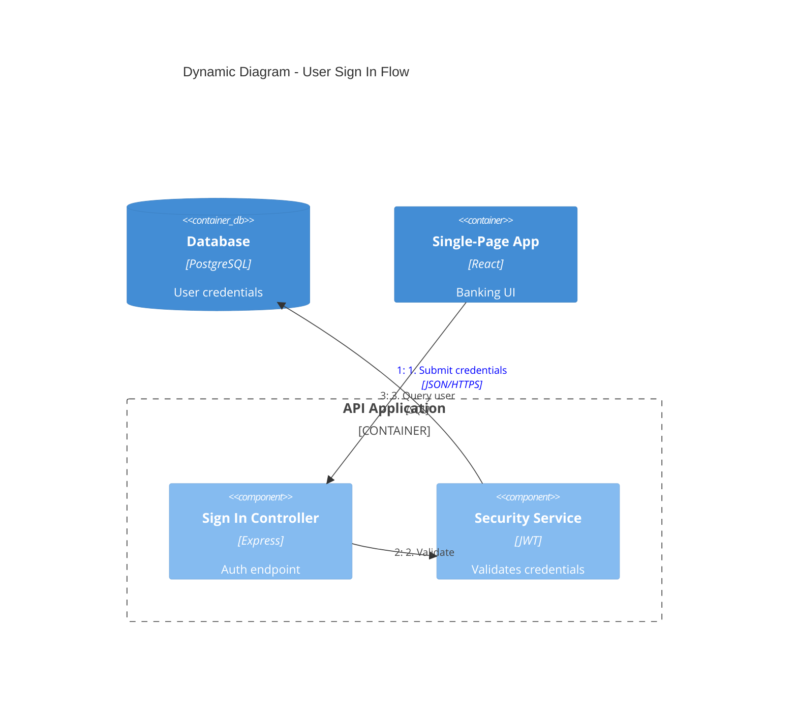
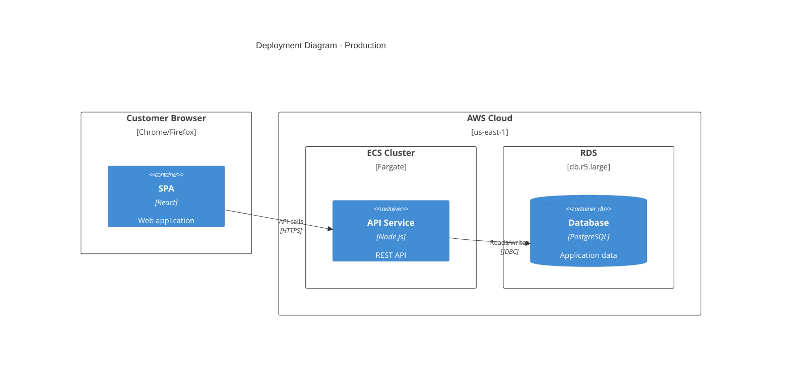

<!-- Source: cherry-picked from https://github.com/coco-research/coco (skills/c4-architecture) on 27.08.2026 per grill decision G-11/11B. Adapted to house format; coco reference files not ported. -->

# C4 Architecture Documentation

Generate architecture documentation using C4 model Mermaid diagrams. Triggers include "architecture diagram", "C4 diagram", "system context", "container diagram", "component diagram", "deployment diagram", "document architecture", "visualize architecture".

## Workflow

1. **Understand scope** — Determine which C4 level(s) are needed based on audience
2. **Analyze codebase** — Explore the system to identify components, containers, and relationships
3. **Generate diagrams** — Create Mermaid C4 diagrams at appropriate abstraction levels
4. **Document** — Write diagrams to markdown files with explanatory context

## C4 Diagram Levels

| Level | Diagram Type | Audience | Shows | When to Create |
|-------|-------------|----------|-------|----------------|
| 1 | **C4Context** | Everyone | System + external actors | Always (required) |
| 2 | **C4Container** | Technical | Apps, databases, services | Always (required) |
| 3 | **C4Component** | Developers | Internal components | Only if adds value |
| 4 | **C4Deployment** | DevOps | Infrastructure nodes | For production systems |
| - | **C4Dynamic** | Technical | Request flows (numbered) | For complex workflows |

**Key insight:** Context + Container diagrams are sufficient for most software development teams. Only create Component/Code diagrams when they genuinely add value.

## Quick Start Examples

### System Context (Level 1)



### Container Diagram (Level 2)



### Dynamic Diagram (Request Flow)



### Deployment Diagram



## Element Syntax

### People and Systems

```
Person(alias, "Label", "Description")
Person_Ext(alias, "Label", "Description")       # External person
System(alias, "Label", "Description")
System_Ext(alias, "Label", "Description")       # External system
SystemDb(alias, "Label", "Description")         # Database system
SystemQueue(alias, "Label", "Description")      # Queue system
```

### Containers and Components

```
Container(alias, "Label", "Technology", "Description")
Container_Ext(alias, "Label", "Technology", "Description")
ContainerDb(alias, "Label", "Technology", "Description")
ContainerQueue(alias, "Label", "Technology", "Description")
Component(alias, "Label", "Technology", "Description")
Component_Ext(alias, "Label", "Technology", "Description")
ComponentDb(alias, "Label", "Technology", "Description")
```

### Boundaries

```
Enterprise_Boundary(alias, "Label") { ... }
System_Boundary(alias, "Label") { ... }
Container_Boundary(alias, "Label") { ... }
Boundary(alias, "Label", "type") { ... }
```

### Relationships

```
Rel(from, to, "Label")
Rel(from, to, "Label", "Technology")
BiRel(from, to, "Label")                        # Bidirectional (avoid; prefer unidirectional)
Rel_U / Rel_D / Rel_L / Rel_R(from, to, "Label") # Direction hints
```

### Deployment Nodes

```
Deployment_Node(alias, "Label", "Type", "Description") { ... }
Node(alias, "Label", "Type", "Description") { ... }  # Shorthand
```

## Styling and Layout

```
UpdateLayoutConfig($c4ShapeInRow="3", $c4BoundaryInRow="1")
UpdateElementStyle(alias, $fontColor="red", $bgColor="grey", $borderColor="red")
UpdateRelStyle(from, to, $textColor="blue", $lineColor="blue", $offsetX="5", $offsetY="-10")
```

Use `$offsetX`/`$offsetY` to fix overlapping relationship labels.

## Best Practices

1. **Every element must have**: Name, Type, Technology (where applicable), and Description
2. **Use unidirectional arrows only** — bidirectional arrows create ambiguity
3. **Label arrows with action verbs** — "Sends email using", "Reads from", not just "uses"
4. **Include technology labels** — "JSON/HTTPS", "JDBC", "gRPC"
5. **Stay under 20 elements per diagram** — split complex systems into multiple diagrams
6. **Start at Level 1**; one diagram per file; meaningful aliases (`orderService` not `s1`); concise descriptions; always include a title

### What to Avoid

- Confusing containers (deployable) vs components (non-deployable)
- Modeling shared libraries as containers
- Showing message brokers as a single container instead of individual topics/queues
- Adding undefined abstraction levels like "subcomponents"
- Removing type labels to "simplify" diagrams

## Microservices Guidelines

- **Single team ownership:** model each microservice as a **container** (or container group) inside one `System_Boundary`.
- **Multi-team ownership:** promote microservices to **software systems** in a Context diagram.
- **Event-driven:** show individual topics/queues as `ContainerQueue` elements (e.g. `order.created`), NOT a single "Kafka" box.

## Output Location

Write architecture documentation to `docs/architecture/`:

- `c4-context.md` — System context diagram
- `c4-containers.md` — Container diagram
- `c4-components-{feature}.md` — Component diagrams per feature
- `c4-deployment.md` — Deployment diagram
- `c4-dynamic-{flow}.md` — Dynamic diagrams for specific flows

## Audience-Appropriate Detail

| Audience | Recommended Diagrams |
|----------|---------------------|
| Executives | System Context only |
| Product Managers | Context + Container |
| Architects | Context + Container + key Components |
| Developers | All levels as needed |
| DevOps | Container + Deployment |
