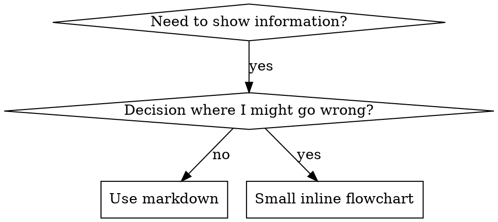

# Writing Skills

## Overview

**Writing skills IS Test-Driven Development applied to process documentation.**

**Personal skills live in agent-specific directories (`~/.claude/skills` for Claude Code, `~/.agents/skills/` for Codex)** 

**Those are DEPLOY TARGETS, not where you author.** Read "Where to author, and the last hop" below before you write a byte: authoring straight into a live tree is what orphans a skill from git, and it has already produced 110 drifted files that no sync can safely resolve in either direction.

You write test cases (pressure scenarios with subagents), watch them fail (baseline behavior), write the skill (documentation), watch tests pass (agents comply), and refactor (close loopholes).

**Core principle:** If you didn't watch an agent fail without the skill, you don't know if the skill teaches the right thing.

**REQUIRED BACKGROUND:** You MUST understand superpowers:test-driven-development before using this skill. That skill defines the fundamental RED-GREEN-REFACTOR cycle. This skill adapts TDD to documentation.

**Official guidance:** For Anthropic's official skill authoring best practices, see anthropic-best-practices.md. This document provides additional patterns and guidelines that complement the TDD-focused approach in this skill.

## What is a Skill?

A **skill** is a reference guide for proven techniques, patterns, or tools. Skills help future Claude instances find and apply effective approaches.

**Skills are:** Reusable techniques, patterns, tools, reference guides

**Skills are NOT:** Narratives about how you solved a problem once

## Lifecycle Metadata (Wave D convention, 2026-08-27)

Skills in the vault (`~/.agents/skills`) carry lifecycle state in their frontmatter `metadata`:

```yaml
metadata:
  status: active        # active | deprecated | tombstoned
  valid_as_of: 2026-08-27   # date the skill's load-bearing facts were last verified on disk/web
```

- **active** — maintained; facts verified as of `valid_as_of`.
- **deprecated** — superseded (name the successor in the body); do not use for new work.
- **tombstoned** — proven dead (dead upstream, retired tool, false claims); body is replaced by a
  short tombstone note saying what killed it and where the replacement lives. Keep the file — a
  tombstone that vanishes gets rebuilt from stale memory (the AgentBridge lesson).
- Absence of the block means the skill predates this convention (treat `valid_as_of` as unknown,
  not as fresh). Audits (e.g. `scripts/harness-audit.js`, gem-hunts) may bump `valid_as_of` only
  after actually re-verifying the skill's external pointers.

## TDD Mapping for Skills

| TDD Concept | Skill Creation |
|-------------|----------------|
| **Test case** | Pressure scenario with subagent |
| **Production code** | Skill document (SKILL.md) |
| **Test fails (RED)** | Agent violates rule without skill (baseline) |
| **Test passes (GREEN)** | Agent complies with skill present |
| **Refactor** | Close loopholes while maintaining compliance |
| **Write test first** | Run baseline scenario BEFORE writing skill |
| **Watch it fail** | Document exact rationalizations agent uses |
| **Minimal code** | Write skill addressing those specific violations |
| **Watch it pass** | Verify agent now complies |
| **Refactor cycle** | Find new rationalizations → plug → re-verify |

The entire skill creation process follows RED-GREEN-REFACTOR.

## When to Create a Skill

**Create when:**
- Technique wasn't intuitively obvious to you
- You'd reference this again across projects
- Pattern applies broadly (not project-specific)
- Others would benefit

**Don't create for:**
- One-off solutions
- Standard practices well-documented elsewhere
- Project-specific conventions (put in CLAUDE.md)
- Mechanical constraints (if it's enforceable with regex/validation, automate it—save documentation for judgment calls)

## Skill Types

### Technique
Concrete method with steps to follow (condition-based-waiting, root-cause-tracing)

### Pattern
Way of thinking about problems (flatten-with-flags, test-invariants)

### Reference
API docs, syntax guides, tool documentation (office docs)

## Directory Structure


```
skills/
  skill-name/
    SKILL.md              # Main reference (required)
    supporting-file.*     # Only if needed
```

**Flat namespace** - all skills in one searchable namespace

**Separate files for:**
1. **Heavy reference** (100+ lines) - API docs, comprehensive syntax
2. **Reusable tools** - Scripts, utilities, templates

**Keep inline:**
- Principles and concepts
- Code patterns (< 50 lines)
- Everything else

## Where to author, and the last hop

Four trees hold skills and only one of them is authoritative. Getting this wrong is the single
most expensive mistake in skill work, because it is silent.

| tree | role |
|---|---|
| `<repo>/.agents/skills/` | **canonical — author HERE** |
| `<repo>/skills/` | generated projection; must be a byte-identical twin (a CI gate enforces it) |
| `~/.agents/skills/` | deploy target (Codex) |
| `~/.claude/skills.daily/` | deploy target — **the one tree Claude Code actually reads** |

**Author in the repo, then deploy. Never the other way round.** A skill edited directly in a
live tree is invisible to git and is overwritten by the next deploy. Measured: 110 files drift
between the curated copies and the vault, and **zero** of them are safe to copy in either
direction — 61 of 64 substantive pairs hold unique content on BOTH sides, so a one-directional
sync destroys real work. Do not reconcile by timestamp either: 72 vault files share one
bulk-deploy mtime, so "newer wins" picks the wrong side in 58 of 64 pairs.

**The last hop:**

```bash
python scripts/deploy-skills-daily.py                      # dry run + drift report (default)
python scripts/deploy-skills-daily.py --self-test          # prove the guards fire
python scripts/deploy-skills-daily.py --apply --only my-skill   # copy, narrowed to one skill
```

It returns a per-file plan and a `SUCCESS:`/`DRY-RUN-OK:` terminal line. It is deliberately
timid: it copies only files where the repo strictly contains the deployed copy (or the deployed
tree has no bytes there), it never creates a skill the live tree does not already have, it never
deletes anything, and `--apply` runs `--self-test` first and aborts if a guard fails.

**When NOT to use it:** it will refuse a two-directionally diverged file, and that refusal is
correct — read both bodies and union-merge by hand. It is also not a prune: two live skills
(`microsoft-foundry`, `qdx-rush`) are absent from repo `skills/`, so any mirror-with-delete
sync deletes them.

## The skill listing budget — why a good description can still be invisible

A skill you cannot see is a skill Claude cannot auto-pick. **Before rewriting a description
that "isn't triggering", check whether it is being rendered at all.** The mechanism is
documented by the vendor; it does not need re-deriving:

<https://code.claude.com/docs/en/skills> — "Skill listing budget", fetched 2026-08-14:

> The listing always contains every skill name, but if you have many skills, Claude Code
> shortens descriptions to fit the listing's character budget... The budget scales at 1% of
> the model's context window. When the listing overflows, Claude Code drops descriptions
> **starting with the skills you invoke least**, so the skills you use most keep their full text.

Three consequences that change what you should do:

1. **A dark skill is a cold-start problem, not a wording problem.** Drop order is
   least-invoked-first, so a never-invoked skill loses its description, which makes it harder
   to auto-pick, which keeps it never-invoked. Rewriting the text cannot break that loop — the
   entry is not in the listing to be read. Several of the currently-dark descriptions on this
   estate are among the best-written in the fleet, which is why "just rewrite them" was
   rejected: it trades good text for nothing while the entry stays hidden.
2. **Every character you add to one description is taken from another skill's.** This surface
   is already over budget. Adding a clause is not free — it pushes the tail further into the
   dark. Prefer a char-neutral edit: add the clause and trim equivalent filler in the same pass.
3. **The per-entry cap is 1,536 characters** for `description` + `when_to_use` combined, and it
   applies independently of the total budget. Text past 1,536 is truncated per-file.
   **There are THREE causes of missing text, not two.** An earlier version of this bullet ended
   "everything else that goes missing went missing to the BUDGET, not to a per-file limit".
   **That dichotomy was REFUTED** and is kept here rather than deleted. The third cause is a
   frontmatter the client cannot parse, which silently substitutes the body `# H1` **at any
   length**: `cv-studio` lost a 729-character description and rendered 74 characters of
   heading, nowhere near the cap. So diagnose in this order — (1) does the frontmatter parse,
   (2) is the entry over 1,536, (3) is it in the least-invoked dark tail. Step (1) is now
   mechanical; see the gate below.

**Read the instruments before theorising** — all three ship with the client:

| instrument | what it answers |
|---|---|
| `/doctor` | estimated listing context cost and its biggest contributors |
| `/context`, Skills row | listing size AFTER the budget is applied = what the model actually received |
| `claude --debug` | writes a warning to the debug log when the listing exceeds its budget |

**The four levers**, in the order worth trying:

| lever | note |
|---|---|
| `skillOverrides: {"<skill>": "name-only"}` | explicit, reversible, zero file edits; frees that entry's characters. Plugin skills are NOT affected by it |
| de-curate the deployed tree | a skill that is not deployed costs nothing |
| `skillListingBudgetFraction` | **measured 0.04 on this estate (4x the 1% default) — this lever is already spent** |
| `skillListingMaxDescChars` | raises/lowers the 1,536 per-entry cap |

**The settling experiment**, if the drop order ever needs re-confirming on this box: invoke a
dark skill once by name (the listing always keeps every NAME, so explicit invocation always
works), start a fresh session, then check whether it gained a description while a different
never-invoked skill lost one.

**Do not** validate these settings against schemastore.org — they are absent from the community
JSON schema, which is schema lag, not evidence that they do not exist.

## SKILL.md Structure

**Frontmatter (YAML):**
- `name` and `description` are the two that matter, but **the schema is not limited to them.**
  `when_to_use`, `argument-hint`, `arguments`, `disable-model-invocation`, `user-invocable`,
  `allowed-tools`, `disallowed-tools`, `model`, `effort`, `context`, `agent`, `background` and
  `hooks` are all supported. Every field is optional; only `description` is recommended.
- **1,024 is NOT the render limit.** The listing truncates `description` + `when_to_use`
  combined at **1,536** characters (`skillListingMaxDescChars`). 1,024 is the agentskills.io
  PACKAGING limit and binds only if you publish the skill as a package. Conflating the two is a
  live defect on this estate: an exemptions list pins five descriptions as "over the 1,024 spec
  max" when only one of them is over any limit that truncates anything.
- `name`: Use letters, numbers, and hyphens only (no parentheses, special chars)
- **A plain (unquoted) YAML scalar has two traps, and the second is worse than the first:**
  - ` #` (space-hash) opens a comment and **silently truncates** the description there.
    Measured live: `bc-drive-plus` lost 440 of its 793 characters to one `#` and rendered in
    the listing as a dangling `...(closes bc-drive's`.
  - `: ` (colon-space) makes the frontmatter **invalid YAML**, and every strict parser
    rejects the whole file — PyYAML, and the packaging and CI that use one. It bit while
    writing the fix for the trap above, which is why the repair script parse-checks the AFTER
    state rather than trusting the edit.
    **An earlier version of this section added "no truncation, no partial text, the entry just
    fails". That was REFUTED**, and is recorded here rather than deleted. Measured across all
    328 curated skills: exactly 7 fail a strict parse, and **5 of the 6 whose `: ` sits in the
    `description` still render in full** in a live listing (`agent-as-judge`,
    `diff-blind-test-synth`, `execution-grounded-bon`, `refactor-equivalence`,
    `rubric-verifier`). The listing is more forgiving than YAML is.
    It stops being forgiving in one measured case: a description written as a **folded (`>`)
    block in a file that is also strict-invalid** loses its description entirely and the entry
    falls back to the body `# H1`. `cv-studio` was the fleet's only such file — a `: ` in its
    *license* line cost it a 729-character description and rendered 74 characters of heading
    instead, until the value was quoted.
    `MODEL, LIKELY (55-80%)` for the why: the client parses strictly first and, on failure,
    recovers a single-LINE description but not a folded block. Not read from client source.
    Settling experiment: take a strict-invalid file whose description is one plain line,
    confirm it still renders, then fold that same description and confirm it drops to the H1.

  Either quote the scalar, or keep both sequences out of it. Whichever you choose,
  **re-parse the file after writing** — the failure mode is silent in both directions.

  **You do not have to remember any of this.** Both traps are gated now; run the gate rather
  than re-deriving them, from an `agent-skills-toolchain` checkout:

  ```
  python ci/check_skill_render_traps.py
  ```

  It blocks a plain scalar carrying ` #`, and a block-scalar `description` in a frontmatter
  that does not strict-parse. It prints the strict-invalid count as ADVISORY — that alone is
  not a render failure, per the refutation recorded above — and exits 2 rather than 0 when it
  cannot measure. CI runs it on every pull request as `gate-skill-render-traps`
  (`.github/workflows/skill-dual-write.yml`), and its suite proves each rule against the real
  blobs that shipped the defect (`ff14d2a6^` bc-drive-plus, `878cd621^` cv-studio) and the
  real blobs that fixed it — not against synthetic mutations.
- `description`: Third-person, describes ONLY when to use (NOT what it does)
  - Start with "Use when..." to focus on triggering conditions
  - Include specific symptoms, situations, and contexts
  - **NEVER summarize the skill's process or workflow** (see CSO section for why)
  - Keep under 500 characters if possible — not because of a per-file cap, but because the
    listing budget is shared and every character you spend is taken from another skill

```markdown
---
name: Skill-Name-With-Hyphens
description: Use when [specific triggering conditions and symptoms]
---

# Skill Name

## Overview
What is this? Core principle in 1-2 sentences.

## When to Use
[Small inline flowchart IF decision non-obvious]

Bullet list with SYMPTOMS and use cases
When NOT to use

## Core Pattern (for techniques/patterns)
Before/after code comparison

## Quick Reference
Table or bullets for scanning common operations

## Implementation
Inline code for simple patterns
Link to file for heavy reference or reusable tools

## Common Mistakes
What goes wrong + fixes

## Real-World Impact (optional)
Concrete results
```


## Claude Search Optimization (CSO)

**Critical for discovery:** Future Claude needs to FIND your skill

### 1. Rich Description Field

**Purpose:** Claude reads description to decide which skills to load for a given task. Make it answer: "Should I read this skill right now?"

**Format:** Start with "Use when..." to focus on triggering conditions

**CRITICAL: Description = When to Use, NOT What the Skill Does**

The description should ONLY describe triggering conditions. Do NOT summarize the skill's process or workflow in the description.

**Why this matters:** Testing revealed that when a description summarizes the skill's workflow, Claude may follow the description instead of reading the full skill content. A description saying "code review between tasks" caused Claude to do ONE review, even though the skill's flowchart clearly showed TWO reviews (spec compliance then code quality).

When the description was changed to just "Use when executing implementation plans with independent tasks" (no workflow summary), Claude correctly read the flowchart and followed the two-stage review process.

**The trap:** Descriptions that summarize workflow create a shortcut Claude will take. The skill body becomes documentation Claude skips.

**The description is a BUDGETED, SHARED resource.** Every installed skill's description is
charged at session start, and the client truncates the listing in order once a cumulative
budget is hit. Measured 2026-08-12: 26-30 CURATED skills rendered with NO description at all
and so could not be auto-picked, while their SKILL.md carried real text on disk (up to 1,750
chars). Diagnosed as budget truncation in listing order, NOT a per-file parse failure. So a long
description does not only cost you — it can push a LATER skill out of the listing entirely.

Two rules follow, and CI enforces both:

- **One line, under 1,024 chars.** A folded or literal YAML block scalar (`description: >`)
  makes the surface non-deterministic to budget.
- **Adding a negative case must be budget-neutral.** "Do NOT use for X, use Y instead" is the
  cheapest recall win available — measured on this repo's 346 canonical skills, 264 say WHEN to
  use but only 60 state a negative case — so pay for the clause by tightening the positive half
  rather than by growing the description.

```bash
python ci/check_skill_description_ratchet.py   # shrink-only ratchet + advisory surface total
```

It is a ratchet, not a ceiling: descriptions that already exceed the limit are pinned in
`ci/skill-description-exemptions.txt`, and the gate REFUSES a stale pin — so that list can only
get shorter. Fix a skill and delete its line in the same change.

```yaml
# ❌ BAD: Summarizes workflow - Claude may follow this instead of reading skill
description: Use when executing plans - dispatches subagent per task with code review between tasks

# ❌ BAD: Too much process detail
description: Use for TDD - write test first, watch it fail, write minimal code, refactor

# ✅ GOOD: Just triggering conditions, no workflow summary
description: Use when executing implementation plans with independent tasks in the current session

# ✅ GOOD: Triggering conditions only
description: Use when implementing any feature or bugfix, before writing implementation code
```

**Content:**
- Use concrete triggers, symptoms, and situations that signal this skill applies
- Describe the *problem* (race conditions, inconsistent behavior) not *language-specific symptoms* (setTimeout, sleep)
- Keep triggers technology-agnostic unless the skill itself is technology-specific
- If skill is technology-specific, make that explicit in the trigger
- Write in third person (injected into system prompt)
- **NEVER summarize the skill's process or workflow**

```yaml
# ❌ BAD: Too abstract, vague, doesn't include when to use
description: For async testing

# ❌ BAD: First person
description: I can help you with async tests when they're flaky

# ❌ BAD: Mentions technology but skill isn't specific to it
description: Use when tests use setTimeout/sleep and are flaky

# ✅ GOOD: Starts with "Use when", describes problem, no workflow
description: Use when tests have race conditions, timing dependencies, or pass/fail inconsistently

# ✅ GOOD: Technology-specific skill with explicit trigger
description: Use when using React Router and handling authentication redirects
```

### 2. Keyword Coverage

Use words Claude would search for:
- Error messages: "Hook timed out", "ENOTEMPTY", "race condition"
- Symptoms: "flaky", "hanging", "zombie", "pollution"
- Synonyms: "timeout/hang/freeze", "cleanup/teardown/afterEach"
- Tools: Actual commands, library names, file types

### 3. Descriptive Naming

**Use active voice, verb-first:**
- ✅ `creating-skills` not `skill-creation`
- ✅ `condition-based-waiting` not `async-test-helpers`

### 4. Token Efficiency (Critical)

**Problem:** getting-started and frequently-referenced skills load into EVERY conversation. Every token counts.

**Target word counts:**
- getting-started workflows: <150 words each
- Frequently-loaded skills: <200 words total
- Other skills: <500 words (still be concise)

**Techniques:**

**Move details to tool help:**
```bash
# ❌ BAD: Document all flags in SKILL.md
search-conversations supports --text, --both, --after DATE, --before DATE, --limit N

# ✅ GOOD: Reference --help
search-conversations supports multiple modes and filters. Run --help for details.
```

**Use cross-references:**
```markdown
# ❌ BAD: Repeat workflow details
When searching, dispatch subagent with template...
[20 lines of repeated instructions]

# ✅ GOOD: Reference other skill
Always use subagents (50-100x context savings). REQUIRED: Use [other-skill-name] for workflow.
```

**Compress examples:**
```markdown
# ❌ BAD: Verbose example (42 words)
your human partner: "How did we handle authentication errors in React Router before?"
You: I'll search past conversations for React Router authentication patterns.
[Dispatch subagent with search query: "React Router authentication error handling 401"]

# ✅ GOOD: Minimal example (20 words)
Partner: "How did we handle auth errors in React Router?"
You: Searching...
[Dispatch subagent → synthesis]
```

**Eliminate redundancy:**
- Don't repeat what's in cross-referenced skills
- Don't explain what's obvious from command
- Don't include multiple examples of same pattern

**Verification:**
```bash
wc -w skills/path/SKILL.md
# getting-started workflows: aim for <150 each
# Other frequently-loaded: aim for <200 total
```

**Name by what you DO or core insight:**
- ✅ `condition-based-waiting` > `async-test-helpers`
- ✅ `using-skills` not `skill-usage`
- ✅ `flatten-with-flags` > `data-structure-refactoring`
- ✅ `root-cause-tracing` > `debugging-techniques`

**Gerunds (-ing) work well for processes:**
- `creating-skills`, `testing-skills`, `debugging-with-logs`
- Active, describes the action you're taking

### 4. Cross-Referencing Other Skills

**When writing documentation that references other skills:**

Use skill name only, with explicit requirement markers:
- ✅ Good: `**REQUIRED SUB-SKILL:** Use superpowers:test-driven-development`
- ✅ Good: `**REQUIRED BACKGROUND:** You MUST understand superpowers:systematic-debugging`
- ❌ Bad: `See skills/testing/test-driven-development` (unclear if required)
- ❌ Bad: `@skills/testing/test-driven-development/SKILL.md` (force-loads, burns context)

**Why no @ links:** `@` syntax force-loads files immediately, consuming 200k+ context before you need them.

## Flowchart Usage



**Use flowcharts ONLY for:**
- Non-obvious decision points
- Process loops where you might stop too early
- "When to use A vs B" decisions

**Never use flowcharts for:**
- Reference material → Tables, lists
- Code examples → Markdown blocks
- Linear instructions → Numbered lists
- Labels without semantic meaning (step1, helper2)

See @graphviz-conventions.dot for graphviz style rules.

**Visualizing for your human partner:** Use `render-graphs.js` in this directory to render a skill's flowcharts to SVG:
```bash
./render-graphs.js ../some-skill           # Each diagram separately
./render-graphs.js ../some-skill --combine # All diagrams in one SVG
```

## Code Examples

**One excellent example beats many mediocre ones**

Choose most relevant language:
- Testing techniques → TypeScript/JavaScript
- System debugging → Shell/Python
- Data processing → Python

**Good example:**
- Complete and runnable
- Well-commented explaining WHY
- From real scenario
- Shows pattern clearly
- Ready to adapt (not generic template)

**Don't:**
- Implement in 5+ languages
- Create fill-in-the-blank templates
- Write contrived examples

You're good at porting - one great example is enough.

## File Organization

### Self-Contained Skill
```
defense-in-depth/
  SKILL.md    # Everything inline
```
When: All content fits, no heavy reference needed

### Skill with Reusable Tool
```
condition-based-waiting/
  SKILL.md    # Overview + patterns
  example.ts  # Working helpers to adapt
```
When: Tool is reusable code, not just narrative

### Skill with Heavy Reference
```
pptx/
  SKILL.md       # Overview + workflows
  pptxgenjs.md   # 600 lines API reference
  ooxml.md       # 500 lines XML structure
  scripts/       # Executable tools
```
When: Reference material too large for inline

## The Iron Law (Same as TDD)

```
NO SKILL WITHOUT A FAILING TEST FIRST
```

This applies to NEW skills AND EDITS to existing skills.

Write skill before testing? Delete it. Start over.
Edit skill without testing? Same violation.

**No exceptions:**
- Not for "simple additions"
- Not for "just adding a section"
- Not for "documentation updates"
- Don't keep untested changes as "reference"
- Don't "adapt" while running tests
- Delete means delete

**REQUIRED BACKGROUND:** The superpowers:test-driven-development skill explains why this matters. Same principles apply to documentation.

## Testing All Skill Types

Different skill types need different test approaches:

### Discipline-Enforcing Skills (rules/requirements)

**Examples:** TDD, verification-before-completion, designing-before-coding

**Test with:**
- Academic questions: Do they understand the rules?
- Pressure scenarios: Do they comply under stress?
- Multiple pressures combined: time + sunk cost + exhaustion
- Identify rationalizations and add explicit counters

**Success criteria:** Agent follows rule under maximum pressure

### Technique Skills (how-to guides)

**Examples:** condition-based-waiting, root-cause-tracing, defensive-programming

**Test with:**
- Application scenarios: Can they apply the technique correctly?
- Variation scenarios: Do they handle edge cases?
- Missing information tests: Do instructions have gaps?

**Success criteria:** Agent successfully applies technique to new scenario

### Pattern Skills (mental models)

**Examples:** reducing-complexity, information-hiding concepts

**Test with:**
- Recognition scenarios: Do they recognize when pattern applies?
- Application scenarios: Can they use the mental model?
- Counter-examples: Do they know when NOT to apply?

**Success criteria:** Agent correctly identifies when/how to apply pattern

### Reference Skills (documentation/APIs)

**Examples:** API documentation, command references, library guides

**Test with:**
- Retrieval scenarios: Can they find the right information?
- Application scenarios: Can they use what they found correctly?
- Gap testing: Are common use cases covered?

**Success criteria:** Agent finds and correctly applies reference information

## Common Rationalizations for Skipping Testing

| Excuse | Reality |
|--------|---------|
| "Skill is obviously clear" | Clear to you ≠ clear to other agents. Test it. |
| "It's just a reference" | References can have gaps, unclear sections. Test retrieval. |
| "Testing is overkill" | Untested skills have issues. Always. 15 min testing saves hours. |
| "I'll test if problems emerge" | Problems = agents can't use skill. Test BEFORE deploying. |
| "Too tedious to test" | Testing is less tedious than debugging bad skill in production. |
| "I'm confident it's good" | Overconfidence guarantees issues. Test anyway. |
| "Academic review is enough" | Reading ≠ using. Test application scenarios. |
| "No time to test" | Deploying untested skill wastes more time fixing it later. |

**All of these mean: Test before deploying. No exceptions.**

## Bulletproofing Skills Against Rationalization

Skills that enforce discipline (like TDD) need to resist rationalization. Agents are smart and will find loopholes when under pressure.

**Psychology note:** Understanding WHY persuasion techniques work helps you apply them systematically. See persuasion-principles.md for research foundation (Cialdini, 2021; Meincke et al., 2025) on authority, commitment, scarcity, social proof, and unity principles.

### Close Every Loophole Explicitly

Don't just state the rule - forbid specific workarounds:

<Bad>
```markdown
Write code before test? Delete it.
```
</Bad>

<Good>
```markdown
Write code before test? Delete it. Start over.

**No exceptions:**
- Don't keep it as "reference"
- Don't "adapt" it while writing tests
- Don't look at it
- Delete means delete
```
</Good>

### Address "Spirit vs Letter" Arguments

Add foundational principle early:

```markdown
**Violating the letter of the rules is violating the spirit of the rules.**
```

This cuts off entire class of "I'm following the spirit" rationalizations.

### Build Rationalization Table

Capture rationalizations from baseline testing (see Testing section below). Every excuse agents make goes in the table:

```markdown
| Excuse | Reality |
|--------|---------|
| "Too simple to test" | Simple code breaks. Test takes 30 seconds. |
| "I'll test after" | Tests passing immediately prove nothing. |
| "Tests after achieve same goals" | Tests-after = "what does this do?" Tests-first = "what should this do?" |
```

### Create Red Flags List

Make it easy for agents to self-check when rationalizing:

```markdown
## Red Flags - STOP and Start Over

- Code before test
- "I already manually tested it"
- "Tests after achieve the same purpose"
- "It's about spirit not ritual"
- "This is different because..."

**All of these mean: Delete code. Start over with TDD.**
```

### Update CSO for Violation Symptoms

Add to description: symptoms of when you're ABOUT to violate the rule:

```yaml
description: use when implementing any feature or bugfix, before writing implementation code
```

## RED-GREEN-REFACTOR for Skills

Follow the TDD cycle:

### RED: Write Failing Test (Baseline)

Run pressure scenario with subagent WITHOUT the skill. Document exact behavior:
- What choices did they make?
- What rationalizations did they use (verbatim)?
- Which pressures triggered violations?

This is "watch the test fail" - you must see what agents naturally do before writing the skill.

### GREEN: Write Minimal Skill

Write skill that addresses those specific rationalizations. Don't add extra content for hypothetical cases.

Run same scenarios WITH skill. Agent should now comply.

### REFACTOR: Close Loopholes

Agent found new rationalization? Add explicit counter. Re-test until bulletproof.

**Testing methodology:** See @testing-skills-with-subagents.md for the complete testing methodology:
- How to write pressure scenarios
- Pressure types (time, sunk cost, authority, exhaustion)
- Plugging holes systematically
- Meta-testing techniques

## Anti-Patterns

### ❌ Narrative Example
"In session 2025-10-03, we found empty projectDir caused..."
**Why bad:** Too specific, not reusable

### ❌ Multi-Language Dilution
example-js.js, example-py.py, example-go.go
**Why bad:** Mediocre quality, maintenance burden

### ❌ Code in Flowcharts
```dot
step1 [label="import fs"];
step2 [label="read file"];
```
**Why bad:** Can't copy-paste, hard to read

### ❌ Generic Labels
helper1, helper2, step3, pattern4
**Why bad:** Labels should have semantic meaning

## STOP: Before Moving to Next Skill

**After writing ANY skill, you MUST STOP and complete the deployment process.**

**Do NOT:**
- Create multiple skills in batch without testing each
- Move to next skill before current one is verified
- Skip testing because "batching is more efficient"

**The deployment checklist below is MANDATORY for EACH skill.**

Deploying untested skills = deploying untested code. It's a violation of quality standards.

## Skill Creation Checklist (TDD Adapted)

**IMPORTANT: Use TodoWrite to create todos for EACH checklist item below.**

**RED Phase - Write Failing Test:**
- [ ] Create pressure scenarios (3+ combined pressures for discipline skills)
- [ ] Run scenarios WITHOUT skill - document baseline behavior verbatim
- [ ] Identify patterns in rationalizations/failures

**GREEN Phase - Write Minimal Skill:**
- [ ] Name uses only letters, numbers, hyphens (no parentheses/special chars)
- [ ] YAML frontmatter with only name and description (max 1024 chars)
- [ ] Description starts with "Use when..." and includes specific triggers/symptoms
- [ ] Description written in third person
- [ ] Keywords throughout for search (errors, symptoms, tools)
- [ ] Clear overview with core principle
- [ ] Address specific baseline failures identified in RED
- [ ] Code inline OR link to separate file
- [ ] One excellent example (not multi-language)
- [ ] Run scenarios WITH skill - verify agents now comply

**REFACTOR Phase - Close Loopholes:**
- [ ] Identify NEW rationalizations from testing
- [ ] Add explicit counters (if discipline skill)
- [ ] Build rationalization table from all test iterations
- [ ] Create red flags list
- [ ] Re-test until bulletproof

**Quality Checks:**
- [ ] Small flowchart only if decision non-obvious
- [ ] Quick reference table
- [ ] Common mistakes section
- [ ] No narrative storytelling
- [ ] Supporting files only for tools or heavy reference

**Deployment:**
- [ ] Skill authored under `<repo>/.agents/skills/`, NOT in a live tree (see "Where to author")
- [ ] Mirrored to `<repo>/skills/` as a byte-identical twin (the dual-write gate rejects a half-edit)
- [ ] Commit skill to git and push to your fork (if configured)
- [ ] Last hop: `python scripts/deploy-skills-daily.py --apply --only <skill>` — without this the
      skill is committed but NOT loaded, because nothing else in the repo writes to the tree
      Claude Code reads
- [ ] Re-run the dry run and confirm your skill is no longer listed as needing a merge
- [ ] Consider contributing back via PR (if broadly useful)

## Discovery Workflow

How future Claude finds your skill:

1. **Encounters problem** ("tests are flaky")
3. **Finds SKILL** (description matches)
4. **Scans overview** (is this relevant?)
5. **Reads patterns** (quick reference table)
6. **Loads example** (only when implementing)

**Optimize for this flow** - put searchable terms early and often.

## The skill listing budget - why a well-written description can render BLANK

**Read this before you "fix" a skill that Claude never auto-picks.** A description that is
excellent on disk can still reach the model as a bare name. That is a RENDER-path budget
mechanism, not a defect in your text, and rewriting the text does not fix it.

Documented at <https://code.claude.com/docs/en/skills> (section "Skill descriptions are cut
short"), fetched 2026-08-13. Verbatim: *"The listing always contains every skill name, but if
you have many skills, Claude Code shortens descriptions to fit the listing's character
budget... The budget scales at 1% of the model's context window. When the listing overflows,
Claude Code drops descriptions starting with the skills you invoke least, so the skills you use
most keep their full text."*

Two distinct mechanisms, applied in this order:

| # | Mechanism | Number | Setting |
|---|---|---|---|
| 1 | Per-entry SHORTENING of `description` + `when_to_use` combined | **1,536 chars** | `skillListingMaxDescChars` |
| 2 | Whole-description DROP once the total overflows | budget = **1%** of the model's context window | `skillListingBudgetFraction`, or `SLASH_COMMAND_TOOL_CHAR_BUDGET` for a fixed char count |

Drop ORDER is **least-invoked-first**. That is a cold-start trap: a new skill is by definition
never invoked, so it is first in line to lose its description, which makes it harder for Claude
to auto-pick, which keeps it never invoked.

### 1,024 is NOT the render limit

`1,024` is the **agentskills.io packaging** limit. The number that governs RENDERING is
**1,536**. Do not shorten a description to 1,024 believing that stops it being truncated, and
do not calibrate a lint/exemption list to 1,024 and call it a render-truncation list.

### Read the instruments before writing a probe

Claude Code already reports all of this. Prefer these over hand-rolled character arithmetic:

- `/doctor` - an estimate of the listing's context cost and its biggest contributors.
- `/context` - the **Skills** row reports the listing size AFTER the budget is applied, i.e.
  what the model actually receives (accurate from v2.1.196; earlier versions over-reported).
- `--debug` - when the listing exceeds its budget, Claude Code writes a warning to the debug log.
- A subagent can read its OWN injected listing; an orchestrator cannot read a subagent's.

### Levers, in the order worth trying

1. `skillOverrides: {"<skill>": "name-only"}` - frees budget explicitly and reversibly with no
   file edit. **Plugin skills are not affected by `skillOverrides`** - manage those via `/plugin`.
2. De-curate the deployed tree. Fewer entries, and no capability is lost while the skill stays
   reachable by explicit name.
3. Raise `skillListingBudgetFraction`. **On this estate it is already `0.04` - 4x the 1% default
   (measured 2026-08-13 by a key-presence read of `~/.claude/settings.json`; no other value was
   read). `skillListingMaxDescChars`, `skillOverrides` and `env.SLASH_COMMAND_TOOL_CHAR_BUDGET`
   are all unset.** The primary lever is therefore already spent here - reach for 1 and 2 first.

### Standing decision: do NOT rewrite a blank-rendering description

Five content-shaped hypotheses (folded YAML scalars, over-length descriptions, non-spec
frontmatter keys, invalid YAML, outright parse failure) have each been refuted with controls -
7 skills carrying invalid-YAML frontmatter render fine. Rewriting trades good text for nothing
while the budget still hides the entry.

One real CONTENT bug does exist and is separate: an unquoted ` #` inside a YAML scalar opens a
comment, so everything after it is silently dropped from the description. Quote the scalar.

Prior art - do not re-derive it: `command-center/grounding/SKILLS-FLEET-GROUNDING.md` already
carried this mechanism ~18 hours before a four-round probing lane re-derived most of it by hand.
Grep `command-center/grounding/` before starting any new measurement campaign.

### ADD, never REPLACE - the deploy hop only carries RIGHT-AHEAD

`scripts/deploy-skills-daily.py` (property P1) copies only files that are **RIGHT-AHEAD** -
"repo strictly contains the deployed copy" - or RIGHT-ONLY-FILE. A DIVERGED file is never
touched. So the moment an edit REMOVES a line that a deployed tree still has, that file can
never be carried by the hop again and needs a hand merge forever.

Measured 2026-08-13: one commit, two edit shapes, opposite outcomes.

| edit shape | file | vault classification afterwards |
|---|---|---|
| pure INSERTION (73 added, 0 removed) | `writing-skills/SKILL.md` | **WOULD-COPY** - still RIGHT-AHEAD, 0 deployed lines lost |
| line REPLACEMENT (12 added, 2 removed) | `design-studio/loop.mjs`, `design-studio-session/session.mjs` | **DIVERGED** - vault `needs_merge` 403 -> 405 |

Both `.mjs` files were byte-identical to the vault beforehand (checked against
`git show HEAD:<path>`, which returns the stored blob); replacing two lines each is exactly
what made them un-deployable. The lost lines were the old `node:fs` import and the old guard.

**Consequence for description work.** Editing an existing `description:` line is a REPLACEMENT,
so every description rewrite permanently orphans that file from the deploy hop in every tree you
do not write by hand. To add trigger phrases or a "do NOT use for X, use Y" negative case
WITHOUT that cost, add a `when_to_use:` key instead of editing `description:`. That is a pure
insertion, and the vendor doc says `when_to_use` is *"Appended to `description` in the skill
listing and counts toward the 1,536-character cap"* - so it reaches the model identically.

Budget still applies: adding text to an already-over-budget listing can push a marginal entry
dark, so pair any bulk enrichment with de-curation or a `skillOverrides` `"name-only"`
elsewhere. Enrich in ONE bulk pass that writes every tree at once, never file-by-file.

### The settling experiment (not yet run)

To convert "vendor doc + correlation" into a measurement on this estate: invoke a never-invoked
skill by explicit name (the listing always keeps every NAME, so explicit invocation always
works), start a fresh session, then check whether that skill gained a description while a
different never-invoked skill lost one. UNVERIFIED as of 2026-08-13 - that experiment has not
been run, and until it is, least-invoked-first is vendor-documented but not locally measured.

### Corrections to the record (2026-08-13) - refuted, not deleted

Two claims this lane shipped were REFUTED by an independent verifier. They are recorded here
rather than quietly dropped, because the wrong remedy is the thing that gets re-derived.

**REFUTED - "the vault carries 2 old-guard files".** The commit message of `1a6d2fee` says the
vault copies *"still carry the old guard (2/2 old there; 0/2 in the three in-scope trees)"*.
That was the 2 files THAT COMMIT HAPPENED TO TOUCH, reported as if it were a census. Re-measured
2026-08-13 by walking every `.mjs`/`.js` in all four trees:

| tree | old lexical guard | `__isMain` | guard-bearing files |
|---|---|---|---|
| `.agents/skills` (repo) | 0 | 10 | 10 |
| `skills` (repo) | 0 | 10 | 10 |
| `~/.claude/skills.daily` (live) | 0 | 10 | 10 |
| `~/.agents/skills` (vault) | **8** | 2 | 10 |

The eight are `design-studio/loop.mjs`, `design-studio-session/session.mjs`, and six of the seven
`ui-audit/*.mjs` - `axe_scan`, `capture`, `critique`, `layout_lint`, `run_audit`, `visual_diff`
(`dead_button_crawl` is already fixed there). **Anyone who applies the 2-file remedy leaves SIX
silent no-ops live in the vault.** Detector control: the same classifier reports 8 on the vault and
0 on all three in-scope trees, so it is not a matcher that says one thing everywhere.

The lesson generalises past this file. A census claim must name the population it walked. "N of the
files I touched" and "N of the files that exist" are different sentences, and only the second one
is a census.

**REFUTED - the receipt hash `e35db962688d588c` for `writing-skills/SKILL.md`.** It corresponds to
no reachable state of that file. The stored blob at `1a6d2fee` and at HEAD is `0cda94f33b56f495`
(33,155 B, 0 CRLF); the Windows working tree is `7c8eb3b38dd15c4c` raw and `0cda94f33b56f495`
LF-normalised. The most plausible provenance is a mid-edit intermediate - that commit applied two
separate inserts. The END STATE was correct and still is (all three in-scope trees identical), but a
receipt naming no reachable state is not evidence of anything. **Publish the METHOD next to the
hash.** On Windows one correct file has three different hashes - stored blob, raw working tree,
LF-normalised working tree - and a bare 16-hex string does not say which was measured.

### The description ratchet: proven to fire, and pointed at the wrong tree

Round 1 asserted that the description instruments "do move when descriptions change" and then cited
an UNCHANGED reading as evidence that its body-only edits cost zero listing budget. An unchanged
reading from an instrument never run against a broken state proves nothing. Measured 2026-08-13 on a
temp copy of the skill root, with `ci/` unmodified and the gate driven through its own
`--root`/`--exemptions` flags:

| state | exit | violations | advisory total |
|---|---|---|---|
| untouched skill root | 0 | 0 | 105,637 |
| ONE description grown to 1,200 chars | **1** | 1, naming the mutated skill | 106,703 |
| mutation reverted | 0 | 0 | 105,637 |

The gate fires when broken, is silent when clean, and the advisory total moves by exactly the char
delta (+1,066). Only now is "body insertions cost zero listing budget" resting on a live instrument.

The same run exposes something larger. `ci/check_skill_description_ratchet.py` measures
`.agents/skills` - 105,637 chars across 346 skills, exit 0. **The client loads
`~/.claude/skills.daily` - 115,461 chars across 328 skills.** Point the SAME gate with the SAME
exemptions file at the tree the client actually reads:

```
python ci/check_skill_description_ratchet.py --root C:/Users/Prekzursil/.claude/skills.daily
```

and it exits 1 with **18 violations**: seven unpinned over-spec descriptions (`agent-as-judge` 1143,
`media-dub` 1312, `orchestration-patterns` 1294, `packaged-artifact-smoke` 1144, `ui-audit` 1091,
`video-watermark-removal` 1154, `workflow-authoring` 1062), eight folded scalars, and three
exemptions pinned to skills that exist in neither repo root (`browser-rail`,
`codex-mixed-workflow-doctrine`, `cookie-bridge`). A gate green on a proxy while the surface the
model actually receives is eighteen-violations red is freezing the wrong number.

Two things follow. First, the fix belongs in `ci/` (outside this lane's write scope): measure both
roots and report the delta, with a fixture that goes RED when a shared description diverges between
them. Second, note what those seven over-spec entries are NOT: every one is below the 1,536-char
render cap, so none of them is actually shortened by the client. They breach the agentskills.io
PACKAGING limit of 1,024, which is a different limit for a different purpose. Do not "fix" a
1,024 violation believing it recovers listing budget - it does not.

### RIGHT-AHEAD is a DIRECTION, and you must check it before you edit

The ADD-vs-REPLACE rule above is necessary but not sufficient: whether an edit is safe also depends
on which side already holds unique lines. Measured on the three files this lane touched:

| file | vault-only lines | repo-only lines | RIGHT-AHEAD |
|---|---|---|---|
| `writing-skills/SKILL.md` | 0 | 127 | yes - append-only edits stay deployable |
| `design-studio/loop.mjs` | 2 | 12 | no - already orphaned by round 1 |
| `design-studio-session/session.mjs` | 2 | 12 | no - already orphaned by round 1 |

So `writing-skills` can absorb more text without cost, and the two `.mjs` files cannot be un-orphaned
by any further additive edit - they need the hand merge. Check the direction with a line-set
containment test before assuming an ADD is free.

### The repair tool cannot reach the files that are still broken

The standing remedy for the eight vault files points at `ui-audit/_fix_main_guard.py`. Run it and
read what it actually does before believing that:

```
$ python .agents/skills/ui-audit/_fix_main_guard.py --help
patched 0:
  skipped axe_scan.mjs: guard not found
  ... (12 more)
SUCCESS:fix-main-guard patched=0
```

Three things at once. It **ignores its arguments entirely** - `sys.argv` is never read, so
`--help`, `--root`, or any path you pass is silently discarded. It hardcodes
`HERE = Path(__file__).resolve().parent` and globs `HERE/*.mjs`, so it can only ever repair the
directory it is sitting in: it cannot target `~/.agents/skills`, and it cannot reach
`design-studio/loop.mjs` or `design-studio-session/session.mjs` in ANY tree, because those are not
in `ui-audit/`. And it prints `SUCCESS:` with `patched=0`, so a run that repaired nothing is
indistinguishable from a run that had nothing to repair.

Put those together and the failure mode is concrete: point it at what you believe is the vault,
get `SUCCESS:fix-main-guard patched=0`, and conclude the vault is clean. It is not - it has eight
old-guard files. The script's own docstring already documents one instance of a repair tool for the
silent-no-op class that silently no-ops. This is a second one, in the same file.

The remedy that actually works, stated so it can be executed rather than assumed: copy the script
into each affected directory of the target tree and run it there (`ui-audit/` covers six of the
eight; `design-studio/` and `design-studio-session/` need it separately), then verify by
CENSUS - walk every `.mjs` and count old-guard vs `__isMain` - not by the script's own exit code.
Do NOT run `sync-skills.ps1 -Prune`: it deletes `microsoft-foundry` and `qdx-rush`.

Generalisable rule: **a repair tool that reports success by exit code, ignores its arguments, and
scopes itself to its own directory is a hazard, not an instrument.** A repair tool should take its
target explicitly, fail closed when the target is missing, and report the count it CHANGED next to
the count it FOUND - `patched=0 found=0` and `patched=0 found=8` must not print the same line.

### A blind vendor find-and-replace is one-way, and the sibling tree is not always the pre-image

A reconcile pass once ran a vendor rename across the trees and shipped it: commit `9513a3bc`
(2026-07-21) ADDED the line `Register as an MCP server (Codex / Codex / Cursor):` to
`.agents/skills/ida-multi-mcp/SKILL.md:74`, where the text had read `Claude Code / Codex / Cursor`.
Three properties make this class expensive, and each has a measurement rather than an opinion.

**1. The rewrite is many-to-one, so it cannot be inverted from the corrupted text alone.** `Claude`,
`claude`, `Claude Code` and `.claude` all collapse onto `Codex` / `.Codex`. Reading
`Codex / Codex / Cursor` you cannot tell which of the two tokens was original, and `~/.Codex/` is
ambiguous in a worse way - it is either a mangled `~/.claude/` that must be RESTORED, or a real
Codex path that must merely be LOWER-CASED, and those are different fixes. The corrupted bytes do
not carry the answer, so recovery needs an external pre-image. Guessing re-corrupts.

**2. "Diff the two skill roots and keep the clean side" recovers less than it appears to.** That
works only while one tree escaped the rewrite. Measured 2026-08-14 across both roots (690
`SKILL.md` files): of the 24 files carrying `~/.Codex/`, **10 carry it identically in BOTH roots**,
so the diff is empty and the corruption is invisible to it. `source-command-save-session/SKILL.md`
holds `~/.Codex/` x4 and `~/.claude/` x0 in the canonical root AND in the projection; its pre-image
is not in the sibling skill tree at all, but in a different artifact family -
`commands/save-session.md`, which holds `~/.claude/` x4 and `~/.Codex/` x0. Establish the pre-image
by PROVENANCE - what was this file ported FROM - not by assuming the other tree is clean.

**3. The detector must be case-SENSITIVE or it measures nothing.** The corrupt marker differs from a
legitimate token only in case, so a case-insensitive matcher cannot separate them. Same walk:

| query | case-sensitive | case-INSENSITIVE |
|---|---|---|
| `~/.Codex/` (corrupt) | 67 hits / 24 files | 89 / 44 |
| `~/.codex/` (legitimate) | 22 hits / 20 files | 89 / 44 |

The case-insensitive column returns the SAME pair of numbers for BOTH queries - it is answering
"does this path appear in any casing", not "is it corrupt". PowerShell `Select-String` is
case-insensitive by DEFAULT and produced exactly this phantom during the sweep that found the
defect; pass `-CaseSensitive`, or use a Python `re` probe without `IGNORECASE`. The durable part is
the SHAPE - one number answering two different questions - not the counts, which move as repairs
land.

**4. And the counts move because DOCUMENTATION carries the markers too.** Every number above was
measured on the tree BEFORE this section existed. Writing it ADDED `~/.Codex/` to the naive census
**six times in this file** - and the file is dual-written, so **twelve** times across the two skill
roots. That delta is a property of this page and holds however the rest of the tree moves; the
ABSOLUTE total it lands on does NOT, because sibling files are under concurrent repair - so do not
quote a post-edit census as though it closed an identity. An earlier revision of this paragraph said
"ten ... five per dual-written root" and reconciled 67 + 10 = 77 "exactly": both terms were wrong
together, which is how a false identity closes (REFUTED 2026-08-14, kept rather than deleted). The
`by:Codex` census moved 1 -> 3 the same way, when a sibling documented the same control in
`systematic-debugging`. So a detector for this class MUST discriminate USE from MENTION - skip fenced
blocks, skip backticked spans - or its first red will be the very paragraph teaching the trap, and
the second will be the gate's own test fixtures. Verify that discrimination before trusting the
count, the same way you verify the case-sensitivity above.

**Both-states control, on blobs that cannot drift.** Run it before trusting any zero; a probe that
is also silent in the BROKEN state has measured nothing:

```
git show 9513a3bc:.agents/skills/ida-multi-mcp/SKILL.md | grep -c "Codex / Codex / Cursor"        # 1 = fires
git show HEAD:skills/ida-multi-mcp/SKILL.md            | grep -c "Codex / Codex / Cursor"        # 0 = silent
git show HEAD:skills/ida-multi-mcp/SKILL.md            | grep -c "Claude Code / Codex / Cursor"  # 1 = real negative
```

The third line is the one people skip, and it is what makes the second mean anything: without it a
typo in the path returns the same reassuring `0`. (Content probe, so the CRLF that `git show`
returns on this box is irrelevant here - it is NOT safe for a formatter check.)

A standing gate for this class, `ci/check_skill_vendor_substitution.py`, is specified but **does not
exist yet** - measured 2026-08-14, `ci/` holds six `check_skill_*` gates and none is it. Until it
lands, run the probe above by hand, and do not cite a gate name as though it were enforcement.

## The Bottom Line

**Creating skills IS TDD for process documentation.**

Same Iron Law: No skill without failing test first.
Same cycle: RED (baseline) → GREEN (write skill) → REFACTOR (close loopholes).
Same benefits: Better quality, fewer surprises, bulletproof results.

If you follow TDD for code, follow it for skills. It's the same discipline applied to documentation.
