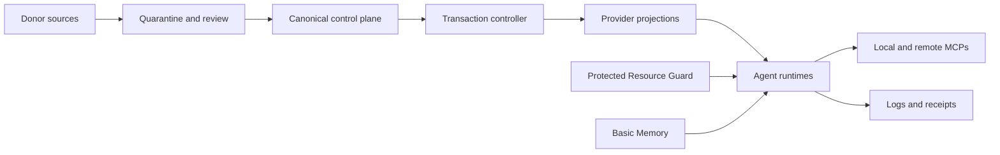

# Provider-neutral AI harness and RAM containment: full audit

**Date:** 29.08.2026  
**Version:** 1.0  
**Scope:** Windows host, canonical `.agents` harness, Claude Code, Codex, Cursor,
Grok, Gemini/Antigravity, Goose, OpenCode, Fabric, Aider, planned Hermes adapter,
MCP transport/lifecycle, Resource Guard, and cloud execution options  
**Evidence posture:** disk-verified unless explicitly marked `AGENT-CLAIMED`,
`NOT-CHECKED`, or `DEFERRED`  
**Secrets:** no credential values were read or recorded

## Executive summary

The immediate RAM incident has a proven recurrence mechanism, but the estate is
not yet fully stabilized. A disk artifact contains 36 process records rooted at
two parentless Cursor Agent PIDs. The incident log records their removal and a
1.579 GiB commit reduction, but no separate post-kill measurement artifact was
found, so that exact reduction remains `AGENT-CLAIMED`. Fresh independent
process mapping still confirms the mechanism: local agent sessions load their
configured stdio MCPs, each `npx` MCP expands into a process tree, and Windows
does not automatically bind those descendants to the lifetime of the parent
agent.

The containment is working for new Cursor sessions: Context7 and Firecrawl are
now remote HTTPS MCPs, and two newer Cursor Agent roots have no local
Context7/Firecrawl `npx` children. Three older Cursor sessions still retain the
old stdio stacks, and Grok currently owns two additional full stdio MCP sets.
Current low free RAM is therefore not evidence of a new orphan: all five Cursor
roots had live parents at the fresh measurement, and Resource Guard reported
zero orphan candidates. The present pressure is a combination of five live
Cursor trees, one large Grok tree, browsers, WSL, Windows Terminal commit, and
4.9 GiB of Memory Compression.

Automatic process termination must remain disabled. The deployed Resource
Guard copy is protected and report-only, but the canonical `.agents` parent
still grants the current Codex sandbox group inherited Modify/Delete-Child.
Protecting `.agents\scripts` alone does not prevent substitution through the
parent directory. In addition, report-only mode has an observability defect:
candidate history is intentionally not persisted and candidate detections are
not surfaced to the digest.

The provider-neutral architecture is sound and appropriately keeps Hermes as
an adapter/canary rather than a policy owner. Its Tier-1 implementation has not
started: the coverage SSOT, `control_plane` package, provenance locks, release
receipts, and transactional controller are absent. The primary `.agents`
repository is heavily dirty and contains many untracked artifacts, so
transactional baselining must precede further activation work.

## Decision status

| Area | Verdict | Evidence |
|---|---|---|
| Cursor orphan recurrence mechanism | **CONFIRMED** | 36-record historical snapshot plus fresh independent process-tree mapping |
| Exact historical 1.579 GiB reduction | **AGENT-CLAIMED** | Recorded in incident report; no separate post-kill artifact found |
| Context7/Firecrawl remote conversion | **PASS** | Live Cursor config, canonical registry, 58 fresh tests |
| New Cursor sessions using remote conversion | **PASS** | Two newer roots had only Chrome DevTools and Playwright stdio children |
| Old sessions fully migrated | **FAIL** | Three old Cursor roots still had Context7 and Firecrawl `npx` children |
| Current Cursor orphan roots | **NONE OBSERVED** | Five roots inspected; every parent was alive; guard candidates = 0 |
| Grok process multiplication | **CONFIRMED** | One Grok root owned two sets of four classified stdio MCP launchers plus four other `npx` launchers |
| Report-only Resource Guard | **CONDITIONALLY PASS** | Protected deployment and repeated successful logs; candidate surfacing gap remains |
| Automatic `-Reap` | **BLOCK** | Unsafe source/deployment trust boundary and same-user mutation risk |
| Tier-1 control plane implementation | **NOT STARTED** | Required package, coverage SSOT, provenance, and release artifacts absent |
| Databricks two-key audit | **DEFERRED / NOT-CHECKED** | Cursor Databricks MCP namespaces require authentication in this session |
| Hermes takeover | **REJECTED** | Adapter/canary is the approved architecture; no second SSOT or memory writer |

## Fresh host measurements

Measurements were taken after the transport containment, not copied from the
earlier incident snapshot.

### RAM and process state

- Free physical RAM fluctuated between approximately 1.3 and 3.9 GiB during the
  observation window.
- Five Cursor Agent roots were live. All five had live parent processes.
- Cursor Agent trees consumed approximately 2.53 GiB working set and 7.10 GiB
  private commit in aggregate.
- The Grok tree contained 63 processes, approximately 0.06 GiB working set, and
  2.26 GiB private commit.
- `npx-cli.js` count: 28.
  - Chrome DevTools: 7
  - Playwright: 7
  - Context7: 5
  - Firecrawl: 5
  - Other Grok-owned launchers: 4
- Three older Cursor roots each owned one Context7, Firecrawl, Chrome DevTools,
  and Playwright launcher.
- Two newer Cursor roots each owned only Chrome DevTools and Playwright. This is
  direct runtime evidence that the remote transport migration is taking effect
  after session restart.
- Grok owned two copies each of Context7, Firecrawl, Chrome DevTools, and
  Playwright. These were live descendants of Grok, not orphans.

Top physical working-set groups:

| Group | Working set | Private commit | Interpretation |
|---|---:|---:|---|
| Memory Compression | 4.90 GiB | 0.04 GiB | Pressure response, not original allocator |
| Node | 2.22 GiB | 8.96 GiB | Cursor and MCP-heavy |
| Edge | 1.43 GiB | 14.31 GiB | Separate major consumer |
| WSL | 0.98 GiB | 5.87 GiB | Separate major consumer |
| Chrome | 0.88 GiB | 5.62 GiB | Separate major consumer |
| Windows Terminal | 0.46 GiB | 9.69 GiB | Abnormally high commit; requires separate diagnosis |

Private commit is not the same as resident physical memory. These figures
explain why terminating a process tree can materially reduce commit without an
immediate equal increase in free physical RAM.

### Resource Guard runtime

- Scheduled Task: `Resource-Guard`
- Principal: `Prekzursil`, S4U, limited run level
- Multiple instances: `IgnoreNew`
- Execution limit: 10 minutes
- Action uses only the protected `.agent-guard\resource-guard` deployment.
- Action does **not** include `-ReapOrphanCursorAgents`.
- Completed runs repeatedly recorded `ORPHAN-GUARD exit=0 apply=0`.
- Latest inspected completed runs reported zero candidates.
- Under severe memory pressure, a read-only Scheduled Task status query took
  approximately 152 seconds. The task showed `Running`, while no completed log
  entry appeared after 22:15 during that observation. The independent follow-up
  later found the task `Ready` with last result `0`, so it recovered; the delay
  remains evidence of intermittent degradation under pressure.

## Root-cause analysis

### Proven recurrence chain

1. A local Cursor or Grok session starts.
2. The runtime discovers global MCP configuration.
3. Every stdio entry launches its command locally.
4. `cmd /c npx` expands into launcher and server descendants.
5. Concurrent sessions multiply identical trees.
6. If the agent root exits without descendant lifecycle binding, the tree can
   survive as an orphan.
7. Repeated sessions accumulate process and commit pressure.

This is not a claim that every duplicate process is an orphan. Fresh mapping
separated live, parented duplication from parentless trees. That distinction is
essential: killing by name or count would terminate valid active sessions.

### Why HTTP helps but does not solve lifecycle generally

Remote Streamable HTTP removes local per-session server processes for services
that already have trusted hosted endpoints. It is therefore the correct
containment for Context7 and Firecrawl. It is not a universal replacement:
local browser automation and tools requiring local files/devices may still need
local execution.

The durable platform fix is parent-owned Windows Job Objects with
`JOB_OBJECT_LIMIT_KILL_ON_JOB_CLOSE`, or an equivalent runtime-owned lifecycle
mechanism. Microsoft documents that this flag terminates every process in the
job when its final handle closes. A post-hoc reaper is defense in depth, not a
substitute for correct process ownership.

## Transport and MCP audit

### Controls that now pass

The canonical registry enforces:

- Context7 and Firecrawl names are permanently `remote-required`.
- Both must use HTTP transport.
- HTTP entries cannot retain stdio `command` or `args`.
- Credential-bearing HTTP endpoints must use HTTPS.
- provider-looking literal key prefixes are rejected.
- credentials remain environment references.

Fresh verification:

- PowerShell orphan-reaper suite: `SUCCESS:cursor-orphan-reaper-tests`
- MCP control-plane and remote policy suites: **58 passed**
- Canonical registry validator: exit 0
- Source and protected deployment hashes: equal for both guard scripts

### Remaining transport debt

1. Three old Cursor sessions must close or restart.
2. Grok still launches Context7 and Firecrawl through stdio and currently owns
   two copies of each.
3. Chrome DevTools and Playwright remain stdio for every Cursor/Grok session.
   They should be activated on demand, moved to a reviewed shared local
   lifecycle owner, or used in isolated cloud runs where appropriate.
4. Cursor remains a filtered/generated projection rather than a first-class
   registry target.
5. Claude/Codex/other consumer projections have not yet been reconciled through
   a transaction controller.
6. Basic Memory is configured through a per-session stdio refresh proxy. The
   `basic-memory` tool namespace was unavailable in this current Cursor session,
   despite the live config entry, and a fresh process census found zero
   `bm_cursor_http_session.py` processes. The proxy did not remain alive for the
   current session. This is a runtime capability mismatch and must be diagnosed
   after session restart without disabling semantic search.

## Resource Guard security review

### What is safe now

The deployed root under `.agent-guard` grants access only to SYSTEM and the
owner. This blocks the sandbox accounts but does not isolate ordinary
same-user Cursor processes from the owner identity. S4U/Limited is not a
separate security identity. The Scheduled Task executes the protected copies,
not the writable canonical tree; report-only mode cannot terminate processes.
Script hashes match the reviewed canonical versions at the time of this audit.

The reaper implementation itself has strong target checks:

- exact Cursor Agent installation-path pattern;
- parent absence;
- process age;
- PID plus creation time;
- complete-tree known CPU and I/O metrics;
- membership-change reset;
- repeated observations;
- immediate identity re-query;
- children-first exact PID termination;
- no kill-by-name and no `/T` discovery.

### Blocking ACL defect

`.agents\scripts` has an explicit read/execute-only ACL for
`CodexSandboxUsers`, but its parent `.agents` still exposes inherited
`Modify, Delete-Child` to that group. The explicit deny present on `.agents`
belongs to an unresolved stale SID, not either current sandbox user. Parent
Delete-Child can authorize rename/deletion/substitution of a protected child.

Consequences:

- canonical guard source cannot be treated as a trusted deployment source;
- a future unverified copy from canonical source into `.agent-guard` could
  promote substituted code;
- enabling automatic reaping before fixing and proving this boundary would turn
  a configuration integrity defect into arbitrary process-termination impact.

### Report-only observability defect

Report-only mode intentionally writes no confirmation state. Therefore:

- observations never accumulate to the three-observation confirmation rule;
- `confirmed` remains zero in report-only mode;
- Resource Guard only surfaces nonzero exit or an actual reap;
- a nonzero `candidates` count is logged but not appended to the digest.

Report-only remains safe, but it is not yet a complete warning system. The next
single-file TDD repair should surface candidate count and age without enabling
termination.

### Independent review reconciliation

The independent security pass agreed that automatic reaping is blocked and
that report-only execution is process-safe but ineffective as orphan
containment. It also identified correctness gaps that must be closed before any
automation reconsideration:

1. Live per-sample CPU/I/O deltas begin at zero; meaningful activity checks
   arise only from persisted inter-run state under `-Apply`.
2. Creation identity is truncated to Unix seconds, leaving a narrow same-second
   PID-reuse edge case.
3. Descendants created after the snapshot are not included in the exact-PID
   kill list.
4. Resource Guard truncates the reaper output before JSON parsing, so a large
   structured result can become unparsable.
5. Resource Guard exits zero even when the micro-guard or telemetry failed, so
   Task Scheduler success is not sufficient evidence of successful monitoring.
6. Current tests do not cover effective deployment ACLs, deployed task
   arguments, late descendants, taskkill failure, same-second PID reuse, or
   report-only candidate alerting.
7. The registry validator constrains Context7/Firecrawl if present but does not
   require both names to exist or pin their approved official HTTPS hosts.

## Provider-neutral control-plane audit

### Approved architecture

The design correctly establishes:

- `.agents` as the canonical live root;
- `AGENTS.md` as the behavior contract;
- `.agents\skills` as the single skill SSOT;
- Basic Memory as the only semantic-memory writer;
- `agents.json` as the only machine-readable registry;
- transactional render, validate, diff, apply, verify, and rollback;
- three-way reconciliation for customized upstream assets;
- marketplaces and plugins as donors, never authorities;
- zero new always-on services in Tier 1;
- Hermes as an adapter/canary, never an SSOT owner.

### Implementation state

The Tier-1 implementation plan exists, but its required first-wave artifacts do
not:

- `.coverage-thresholds.json`: absent
- `control_plane/`: absent
- `provenance/*.lock.json`: absent
- `releases/`: absent

Accordingly, no Tier-1 implementation or completion claim is valid. The
implementation plan itself is currently untracked. A plan-review completion
receipt was not found on disk and is therefore `NOT-CHECKED` under the
fail-closed doctrine.

The canonical repository is on branch
`wip/harness-additions-2026-08-28` and is heavily dirty, with both modified
tracked files and a large set of untracked reports, scripts, tests, skills, and
workflows. This is not evidence that the files are wrong; it is evidence that
there is no clean transactional baseline from which to prove unrelated-file
preservation.

## Threat model

### Scope and assumptions

- The host and repositories are owner-controlled.
- The realistic adversary is untrusted or compromised agent-executed code,
  donor content, package supply-chain content, or an accidental same-user
  mutation.
- No third-party attack target is in scope.
- Remote MCP endpoints are internet reachable, but local control-plane files
  are not intentionally exposed as network services.
- Secrets may exist in environment variables or protected stores; only
  references are permitted in generated config and evidence.

### System model

### Assets and objectives

| Asset | Why it matters | Objective |
|---|---|---|
| Canonical rules, skills, hooks, and MCP registry | Determines agent behavior and tool authority | Integrity |
| Provider configs and sessions | Grants runtime capability and may reference credentials | Confidentiality, integrity |
| Resource Guard code/state | Can authorize process termination | Integrity, availability |
| Evidence, logs, and release receipts | Basis for rollback and completion claims | Integrity, availability |
| Basic Memory vault | Sole durable semantic memory | Confidentiality, integrity, availability |
| Host RAM and process capacity | Required for all local tools | Availability |

### Threat table

| ID | Threat | Existing controls | Gap | Likelihood | Impact | Priority |
|---|---|---|---|---|---|---|
| TM-001 | Sandbox or same-user code substitutes canonical guard source, later promoted into protected deployment | Protected `.agent-guard`, hash comparison | Parent `.agents` Delete-Child remains; no signed/transactional promotion | High | High | **High** |
| TM-002 | Independent writers regress remote MCPs to stdio, recreating per-session process farms | `remote-required` validator and 58 tests | Not all provider writers are retired or routed through one controller | Medium | High | **High** |
| TM-003 | Agent exits leave MCP descendants alive until RAM/commit exhaustion | Conservative reaper, remote transport, logging | No parent-owned Job Object; automatic reap disabled | High | High | **High** |
| TM-004 | Candidate orphan is logged but not surfaced, delaying operator response | Five-minute report-only task | No report-only observation persistence or candidate digest | Medium | Medium | **Medium** |
| TM-005 | Dirty/unbaselined deployment overwrites unrelated capabilities or secrets | Approved transaction design | Controller and pre-image receipts not implemented | Medium | High | **High** |
| TM-006 | Raw hook or MCP payloads leak secrets into logs | Some redaction and protected paths | Shared structural redaction/migration remains incomplete | Medium | High | **High** |
| TM-007 | Unpinned `npx @latest` supply-chain or update drift changes executable behavior | Registry review and environment references | Playwright/Chrome DevTools still float and launch per session | Medium | High | **High** |
| TM-008 | Multiple memory writers create contradictory durable truth | Basic Memory contract | Native/provider caches and current Basic Memory runtime mismatch | Medium | Medium | **Medium** |
| TM-009 | Cloud agents receive broader repo or credential scope than necessary | Cloud isolation and API authentication | No canonical cloud dispatch scrub/allowlist receipt yet | Medium | High | **High** |

## Cursor SDK and cloud-agent streamlining

Cursor's current v1 Cloud Agents API and TypeScript/Python SDKs support durable
agents with per-prompt runs. The SDK exposes one interface for local and cloud
runtimes. Current official documentation also states that cloud agents can load
inline or dashboard-managed MCP servers, including authenticated HTTP MCPs.

Recommended integration:

1. Keep one local Cursor Agent for Windows-only work.
2. Route portable repository work to cloud runs through a future
   `agents-cp dispatch cursor-cloud` adapter.
3. Use only scrubbed committed inputs or an explicit bounded artifact bundle.
4. Default cloud MCP exposure to a small allowlist of remote HTTPS services.
5. Never forward browser cookies, owner profiles, local session stores, or the
   Basic Memory vault.
6. Use service-account/user API keys through protected environment references;
   never serialize them into prompts, batch files, or receipts.
7. Require spend approval, model allowlist, run budget, artifact AND-gate, and a
   capability delta before launch.
8. Treat the v1 API as beta and pin SDK/API compatibility with contract tests.

Cloud agents reduce local RAM pressure and survive caller disconnects. They do
not replace local-only browser, Windows process, RE, or private-session work.

## Databricks status

Databricks remains a valid remote fan-out lane for portable, high-volume Codex
work. Existing measured doctrine supports a policy-bound single-node job
cluster, concurrency 48, and a three-second launch stagger. It explicitly bans
uploading browser cookies or full tokens and requires artifact existence plus a
completion sentinel.

The requested audit of the two functional Databricks credentials is not
complete. Both Databricks MCP namespaces presented by this Cursor session
reported `needsAuth`. The CLI enumerated four configured profiles
(`DEFAULT`, `bolt-datascience`, `bolt-common`, and `bolt-geo`) and marked all
four `Valid: NO`. This contradicts the assumption that two keys are currently
wired into the CLI or plugin authentication planes; the two functional values
may exist elsewhere, but that was not inferred or exposed. No credential value
was inspected, no key was rotated, and no workspace mutation was attempted.
This must remain a separate, read-only credential/profile and
workspace-capability audit rather than being folded into the RAM incident.

## Hermes, Fabric, and secondary runtimes

### Hermes

Hermes offers useful provider-neutral execution, messaging gateways, scheduling,
skills, memory, and remote backends. Those strengths are exactly why it must not
be allowed to create a second policy, skill, or memory authority. The approved
role is:

- consume canonical skills/rules through an adapter;
- use Basic Memory through the existing memory contract;
- run a canary after Tier-1 transactions and rollback pass;
- graduate only on measured capability, security, and resource criteria.

### Fabric

Fabric is a stateless pattern/model consumer, not a control-plane owner. The
direct Gemini wrapper may isolate estate-wide proxy variables for the child
process, but provider/model settings, downloaded patterns, and secrets must
remain declared and non-canonical.

### Grok, Goose, Gemini/Antigravity, OpenCode, and Aider

These remain secondary adapters after Tier 1. Fresh evidence shows Grok is not
merely theoretical: it currently multiplies stdio MCP stacks. Its adapter
therefore needs transport normalization and lifecycle accounting early in the
secondary wave. Antigravity requires explicit UTF-8/BOM conformance tests.

## Prioritized remediation

### P0: stabilize without enabling destructive automation

1. Close or restart the three old Cursor sessions that still own local
   Context7/Firecrawl processes.
2. Keep automatic `-Reap` disabled.
3. Preserve the protected report-only deployment.
4. Investigate the 9.69 GiB Windows Terminal private commit and browser/WSL
   consumers separately; do not mislabel them MCP orphans.
5. Stop creating additional local agent sessions while free RAM is below
   8 GiB.

### P1: close the guard gaps

1. Correct `.agents` parent ACLs for both current sandbox SIDs and mutation-test
   child substitution/rename.
2. Add a manifest/hash-verified promotion step from canonical source to
   `.agent-guard`.
3. TDD a report-only candidate alert that surfaces candidate count and age
   without persisting kill authorization.
4. Preserve full-precision creation identity, re-enumerate descendants
   immediately before any kill, parse structured output before log truncation,
   and propagate a non-success task result on monitoring failure.
5. Require Context7 and Firecrawl to exist at their approved HTTPS hosts in the
   production registry validator, not only in tests.
6. Add a one-local-agent launcher using a named mutex plus a Windows Job Object.
   Do not shadow vendor binaries; expose it through the canonical CLI/profile
   wrapper and report direct-launch bypasses.
7. Keep exact-PID manual cleanup as the reviewed fallback.

### P2: begin Tier-1 implementation

1. Re-establish a path/status/hash baseline for the dirty primary repository.
2. Obtain/store the missing plan-review receipt.
3. Implement WU-A1 coverage SSOT first.
4. Freeze unsafe deployment writers.
5. Build transaction journal, CAS, rollback, and receipts.
6. Convert Claude, Codex, and Cursor to first-class adapters.
7. Retire every independent activation writer replaced by the controller.

### P3: secondary adapters and remote execution

1. Normalize Grok MCP transports.
2. Add Cursor SDK cloud dispatch with scrubbed input and artifact receipts.
3. Complete the two-profile Databricks audit.
4. Add Hermes only as a measured canary.
5. Continue with Goose, Gemini/Antigravity, OpenCode, Fabric, and Aider.

## Verification ledger

| Check | Result | Provenance |
|---|---|---|
| Orphan reaper PowerShell tests | PASS | Fresh execution, 26.4 s |
| MCP policy tests | PASS, 58 tests | Fresh execution, 3.19 s |
| Registry validation | PASS, exit 0 | Fresh execution |
| Protected/source script hashes | PASS, both equal | Fresh SHA-256 comparison |
| Resource Guard scheduled action | PASS report-only, intermittently delayed | Follow-up found Ready/0 after an observed pressure delay |
| Automatic reap safety | BLOCK | Fresh ACL inspection |
| Current orphan candidate count | 0 | Fresh guard logs |
| Historical two-root snapshot | PASS, 36 records | Disk artifact re-read |
| Exact historical commit reduction | AGENT-CLAIMED | No separate post-kill artifact |
| Tier-1 coverage gate | NOT-CHECKED | Threshold file absent |
| Tier-1 release receipt | NOT-CHECKED | Release artifacts absent |
| Databricks profiles/workspaces | FAIL authentication preflight | Both MCPs need auth; four CLI profiles report invalid |
| Basic Memory recall | FAIL runtime preflight | Namespace absent and proxy process count zero |

## Sources

1. Cursor, [MCP in the CLI](https://cursor.com/docs/cli/mcp) — automatic
   discovery and shared editor/CLI configuration.
2. Cursor, [Cloud Agents API](https://cursor.com/docs/cloud-agent/api/endpoints)
   — v1 durable agents and per-run API.
3. Cursor, [TypeScript SDK](https://cursor.com/docs/sdk/typescript) and
   [Python SDK](https://cursor.com/docs/sdk/python) — local/cloud runtimes and
   MCP configuration.
4. Model Context Protocol,
   [Streamable HTTP transport](https://modelcontextprotocol.io/specification/2026-07-28/basic/transports/streamable-http)
   — current transport and security requirements.
5. Microsoft,
   [Job Object limit information](https://learn.microsoft.com/en-us/windows/win32/api/winnt/ns-winnt-jobobject_basic_limit_information)
   and
   [SetInformationJobObject](https://learn.microsoft.com/en-us/windows/win32/api/jobapi2/nf-jobapi2-setinformationjobobject)
   — `JOB_OBJECT_LIMIT_KILL_ON_JOB_CLOSE`.
6. Nous Research,
   [Hermes Agent](https://github.com/NousResearch/hermes-agent/) and
   [documentation](https://hermes-agent.nousresearch.com/docs/).
7. Local incident evidence:
   `docs/incidents/2026-08-29-cursor-agent-mcp-orphan-ram.md`.
8. Approved architecture:
   `docs/plans/2026-08-29-provider-neutral-ai-harness-design.md`.
9. Tier-1 plan:
   `docs/plans/2026-08-29-provider-neutral-ai-harness-implementation_v2.md`.

## Final conclusion

The estate has a correct architectural direction and a proven partial
containment, not a finished fix. The remote MCP invariant materially reduces
new Cursor process growth. The remaining immediate pressure comes from old and
concurrent live sessions plus unrelated major allocators, while automatic
cleanup remains unsafe to enable. The next correct move is to close old
sessions, repair the parent ACL and report-only alert gap, then start the
transactional Tier-1 plan from a verified dirty-state baseline.

REPORT-COMPLETE: provider-neutral-harness-ram-audit-2026-08-29
