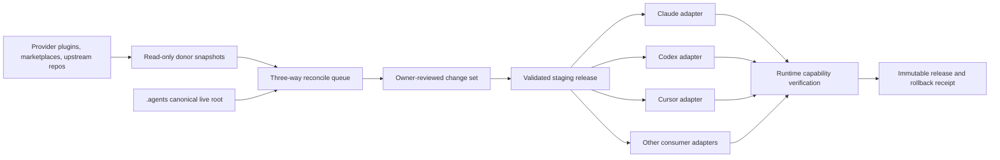

# Provider-neutral AI harness control plane

**Date:** 29.08.2026  
**Status:** Approved; five-role design-review gate passed after blocker reconciliation  
**Canonical live root:** `C:\Users\Prekzursil\.agents`  
**Scope:** Claude Code, Codex, Cursor, Goose, Grok, Gemini CLI, Antigravity,
OpenCode, Fabric, Aider, and a later Hermes Agent canary

## 1. Goal

Create one provider-neutral control plane for the owner's AI tool estate without
silently removing capabilities, copying secrets into managed artifacts, or
allowing provider marketplaces and runtime-specific profiles to become competing
sources of truth.

The control plane governs:

- skills and command aliases;
- MCP definitions, health policy, and per-consumer exposure;
- rules and behavior pointers;
- hooks and enforcement classifications;
- semantic-memory authority and cache boundaries;
- native plugin dependencies;
- donor provenance and update reconciliation;
- consumer-specific generated configuration;
- runtime verification, rollback, and release receipts;
- periodic metadata-only discovery of candidate skills and MCPs.

## 2. Binding decisions

1. `C:\Users\Prekzursil\.agents` remains the live harness-at-root and canonical
   control-plane root.
2. `C:\Users\Prekzursil\AGENTS.md` remains the behavior contract.
3. `C:\Users\Prekzursil\.agents\skills` remains the canonical skill vault.
4. Basic Memory remains the canonical semantic-memory writer.
5. Provider-native memories may remain only as isolated caches. Promotion of a
   durable fact must pass through Basic Memory.
6. Provider-native plugins that cannot be ported may remain as declared
   dependencies with capability tests and a fallback.
7. Provider marketplaces, plugin stores, repositories, and registries are donor
   and discovery sources, never runtime authority.
8. Upstream updates never overwrite customized assets automatically. Every
   customized update is a three-way reconciliation.
9. No credential, token, key, or session is rotated. Existing sessions are
   preserved.
10. No capability is silently removed or downgraded. Every intentional loss
    requires an impact report and owner decision.
11. Discovery may create candidate reports only. It may not install, execute,
    enable, or promote candidates.
12. Hermes may become the preferred execution front end or scheduler after a
    canary, but it never owns canonical policy or state.

## 3. Evidence that motivates the design

### 3.1 Authority and deployment drift

- Live `.agents` and `source\agent-skills-toolchain` are independent dirty
  clones on different branches.
- A third toolchain clone and many scratch clones create provenance ambiguity.
- The live and repository harness copies differ materially.
- Repository `scripts\sync-skills.ps1` explicitly removes and recopies each
  target skill and may prune unmatched skills.
- `sync_shared_state.ps1` validates and publishes MCP views, then merges only
  Claude, Codex, and Cursor. It does not deploy rules or other consumers.

### 3.2 Skills, rules, and command drift

- The canonical vault has roughly 374 skill directories, while provider plugin
  and marketplace trees expose many additional overlapping skills.
- The deployed skill manifest covers only a minority of the live vault.
- `.agents\rules` is currently gitignored and incomplete, while the Claude rule
  tree is materially larger.
- The Codex rule tree contains duplicated hierarchy.
- `source-command-rules-distill` points to a missing full `rules-distill`
  workflow.
- Requested names such as `create-workflow`, `agents-dashboard`, `mcps`, and
  `harness-audit` do not consistently resolve to canonical skills even though
  neighboring implementations exist.

### 3.3 MCP drift

- `agents.json` currently validates only `claude` and `codex` targets.
- Cursor is a hard-coded filtered Claude projection with a six-server keep-list,
  not a first-class target.
- Claude, Codex, Grok, Gemini, Goose, and other consumers retain manual or
  plugin-provided MCP surfaces outside the registry.
- A Claude HTTP renderer test fails because the rendered entry omits the
  required transport type.
- Antigravity has experienced BOM-related configuration failure.

### 3.4 Enforcement and telemetry drift

- Claude, Codex, and Cursor use different hook stacks.
- Several controls are prompt-only, shadow, advisory, or opt-in.
- Cursor loggers persist command excerpts or full hook payloads without shared
  structural redaction, locking, rotation, or retention.
- Large terminal and hook JSONL files contain malformed or failed records.
- The deployment baseline is stale or shapeless, and missing baseline state can
  appear healthy.
- Presence-based harness scores do not establish runtime behavior.
- Codex contains `git-always-force-push=true`, which conflicts with the binding
  safety contract.

### 3.5 Memory drift

- Basic Memory is contractually canonical, but Claude plugin paths, Codex native
  memories, Gemini memory MCP, checkpoints, spools, and session digests create
  competing persistence.
- Session-start digest selection does not consistently preserve poison,
  supersession, project, and freshness controls.
- Basic Memory returned both a timeout and a session error during this audit.

## 4. Architecture



### 4.1 Canonical state

`agents.json` is the **only machine-readable canonical registry**. Its schema is
extended in place with consumers, asset ownership, asserted policies,
provenance, and per-consumer capability grants. There is no second overlapping
manifest. Provider-native files and any human-readable status pages are
generated projections.

The canonical root contains:

- extended `agents.json` registry (MCP remains backward compatible);
- canonical skill/rule/hook/module implementations;
- asserted safety policies;
- provenance lock records for imported assets;
- adapter code and adapter conformance tests;
- workflow definitions and verification contracts.

Runtime logs, staging output, deploy backups, session data, and generated
consumer views remain local and gitignored.

`sync_shared_state.ps1` remains the compatibility entry point, but it is not a
second activation authority. It delegates to the transaction controller. The
existing provider mergers become adapter libraries or are explicitly retired;
they may not write consumer files independently once the controller is active.

### 4.2 Asset provenance

Every imported asset records:

- canonical identifier and asset class;
- original source and original provider;
- source revision/version and content hash;
- license and maturity status;
- last imported upstream hash;
- current canonical local hash;
- local customization status;
- security/review status;
- supported consumers and capability requirements;
- review date and update policy.

### 4.3 Three-way reconciliation

For an upstream update:

1. retrieve metadata and content into quarantine;
2. compare the last imported upstream base with the new upstream content;
3. compare the same base with the current customized canonical content;
4. auto-classify only:
   - upstream-only change;
   - local-only change;
   - identical change;
   - true conflict;
5. render a bounded review artifact;
6. require explicit approval for every conflict or capability-impacting change;
7. promote only the reviewed result.

Generated consumer output is never accepted as an upstream source.

Assets without a known last-imported base are classified `unknown-base`.
They cannot auto-merge. Phase 0 retains them, captures provenance, and requires
owner adjudication before a baseline is created. “Newest wins”, timestamps, and
repository location are never conflict-resolution rules.

At Phase 0 exit:

- `.agents` is the only writable canonical root;
- `source\agent-skills-toolchain` is a versioned export/donor history;
- `source\ast-patch167`, `_wu*`, `_verify*`, and other clones are classified as
  donor, scratch, archive, linked worktree, or retained independent repository;
- no donor or scratch clone may deploy into `.agents`;
- every live-only unmatched asset is retained until explicitly adjudicated.

The current destructive `sync-skills.ps1` is disabled as an activation path.
Before any other work, it gains a source-equals-destination, parent/child, and
reparse-alias hard stop with a known-broken fixture. From Phase 0 until the
transaction controller is verified, **all donor/repo→live skill deployment is
temporarily frozen**: skills already live remain usable, but new/updated skills
stay staged. Deployment resumes only through an approved transaction. This
temporary capability impact is explicit and appears as `ACTION_REQUIRED`; no
unscoped/default or `-Prune` execution is permitted.

### 4.4 Consumer capability manifest

For every consumer and asset class, record one of:

- `native`
- `emulated`
- `advisory`
- `unsupported`
- `not-tested`

Each consumer also declares:

- actual Windows configuration path;
- format, schema, encoding, and BOM policy;
- managed and unmanaged sections;
- native marketplace/plugin behavior;
- secret-reference syntax;
- approval and hook semantics;
- skill/rule size and discovery limits;
- MCP transport and resource limits;
- reload/restart behavior;
- runtime smoke command;
- rollback method.

Behavioral parity is never inferred from file presence.

## 5. Adapter contract

Every adapter implements:

1. `discover` — locate the installed consumer and active config.
2. `inventory` — return a redacted structural inventory.
3. `render` — create native output in staging.
4. `validate` — parse and schema-check staged output.
5. `diff` — show managed changes and preserved unmanaged state.
6. `apply` — atomically activate the staged view.
7. `verify` — execute a consumer-native smoke journey.
8. `rollback` — restore the prior verified release.

Unknown fields are preserved and reported. Unsupported required semantics stop
the adapter; they are never omitted silently.

### 5.1 Adapter privilege boundary

Each adapter is default-deny and declares:

- exact canonical inputs it may read;
- exact native paths it may read or write;
- approved executables and runtime probes;
- required environment-variable **names**, never values;
- whether reparse points/junctions are expected;
- maximum bytes, files, processes, runtime, and working-set increase;
- exact network destination, protocol, port, and operation allowlists;
- exact privileged operation, command, and path allowlists.

Unlisted paths, executables, reparse points, elevation, or capability expansion
stop the adapter. Network access defaults to none. Elevation defaults to
forbidden; a privileged operation requires a separate owner approval bound to
the exact staged artifact and transaction. Adapters cannot read auth/session
material into model context.

This is application-level mediation, not an OS sandbox. Concrete adapters may
not call filesystem, subprocess, socket, or environment-value APIs directly.
An AST/import/call-site lint plus mediator-negative tests enforce that rule.
Any residual ambient-process privilege is labeled advisory and is not credited
as containment.

### 5.1.1 Tier-1 default-deny grants

All path grants are exact after environment/home expansion. Reads follow no
unexpected reparse point. Writes are limited to the managed target or staging.
Environment grants are the **names** declared in
`agents.json.mcp.servers.*.requiredEnv`; values are never inventoried.

| Consumer / operation | Read | Write | Executables | Network | Elevation |
|---|---|---|---|---|---|
| Claude `discover/inventory` | `.claude.json`, `.claude\settings.json`, `.claude\skills`, `.claude\skills.daily`, `.claude\rules`, `.agents\rules-canonical`, home `AGENTS.md`, canonical registry | none | none | none | forbidden |
| Claude `render/validate` | canonical registry + captured structural inventory | transaction staging only | Python interpreter pinned by controller | none | forbidden |
| Claude `apply/rollback` | staged output, exact live target hashes/metadata, protected pre-images | `.claude.json` managed `mcpServers`; `.claude\settings.json` approved hooks subtree; exact `.claude\skills` and `.claude\skills.daily` links; approved `.claude\rules` projection | transaction controller only | none | forbidden |
| Claude `verify` | generated receipt and native read-only status | receipt only | exact installed `claude` binary: version/doctor/MCP list commands allowlisted individually | only canonical MCP health destinations selected for the test | forbidden |
| Codex `discover/inventory` | `.codex\config.toml`, `.codex\AGENTS.md`, `.codex\rules`, `.agents\rules-canonical`, home `AGENTS.md`, canonical registry | none | none | none | forbidden |
| Codex `render/validate` | canonical registry + captured structural inventory | transaction staging only | pinned Python/TOML parser | none | forbidden |
| Codex `apply/rollback` | staged output, exact live target hashes/metadata, protected pre-images | managed MCP/hooks/asserted-setting marker blocks in `.codex\config.toml`; approved `.codex\rules` projection | transaction controller only | none | forbidden |
| Codex `verify` | generated receipt and native read-only status | receipt only | exact installed `codex` binary: version/MCP list/read-only doctor commands allowlisted individually | only canonical MCP health destinations selected for the test | forbidden |
| Cursor `discover/inventory` | `.cursor\mcp.json`, `.cursor\hooks.json`, `.cursor\settings.json`, home `AGENTS.md`, canonical registry | none | none | none | forbidden |
| Cursor `render/validate` | canonical registry + captured structural inventory | transaction staging only | pinned Python/JSON parser | none | forbidden |
| Cursor `apply/rollback` | staged output, exact live target hashes/metadata, protected pre-images | exact managed `.cursor\mcp.json`, `.cursor\hooks.json`, `.cursor\settings.json` changes only | transaction controller only | none | forbidden |
| Cursor `verify` | generated receipt and native read-only status | receipt only | exact installed Cursor CLI/binary read-only status command; never more than one `cursor-agent` | only canonical MCP health destinations selected for the test | forbidden |

Every native command is stored as an argv allowlist, not shell text. A command
that can log in/out, refresh/revoke/create credentials or sessions, rotate keys,
send messages, mutate repositories, install/update plugins, or change remote
state is excluded from smoke verification. If a consumer lacks a session-neutral
status command, verification is `NOT_TESTED`; the controller does not improvise.

The transaction controller has one Windows-only privileged-metadata helper:
the system `icacls.exe`, allowed only with exact argv templates that set or
verify the current owner SID's access on the transaction's rollback/cache
subdirectory. It may not recurse outside that content-addressed directory,
change ownership, grant any principal other than the current owner SID and
local SYSTEM (`S-1-5-18`), or run elevated. Missing or failed ACL verification
produces `FAILED_TO_RUN`.

For a newly created empty rollback/cache directory under an already protected
parent, the only write template is one invocation, so no empty-DACL interval
exists:

```text
icacls.exe <exact-directory> /inheritance:r /grant:r *<owner-SID>:(OI)(CI)F *S-1-5-18:(OI)(CI)F
```

Locale-invariant verification uses a pinned/hash-verified PowerShell script:

```text
pwsh.exe -NoProfile -NonInteractive -File <verify-acl.ps1> -Path <exact-directory> -OwnerSid <owner-SID>
```

It reads .NET `DirectorySecurity`/SDDL and requires only the owner SID and local
SYSTEM (`S-1-5-18`) full-control allow ACEs, with no inherited or deny ACE.
Files are created only after that check and inherit the directory ACL. Any
extra principal, parse ambiguity, or command failure is `FAILED_TO_RUN`.

Bootstrap base case: `.agents\deploy-backups` and the cache root are created
empty, receive the same one-invocation ACL before any child/content is created,
and pass SDDL verification before use. No credential/session/pre-image bytes
exist during the inherited-ACL interval.

### 5.1.2 Controller default-deny grant

The controller is subject to the same mediator; it has no ambient-write
exception.

| Operation | Exact grants |
|---|---|
| Read | canonical `agents.json`; `rules-canonical`; transaction staging/journal; versioned release/provenance receipts; protected pre-images only during authorized rollback; exact native targets through adapter handles |
| Write | `.agents\staging\<transaction>`; `.agents\state\control-plane`; `.agents\deploy-backups\<transaction>`; `.agents\releases\<release>`; `.agents\provenance`; transaction-managed `C:\Users\Prekzursil\.local\bin\agents-cp.cmd`; exact native targets only through adapter handles |
| Execute | pinned Python; pinned `agents-cp.ps1`; exact `icacls.exe` and `verify-acl.ps1` templates; session-neutral consumer argv only through verify handles |
| Network | none except exact read-only MCP health destinations through verify handles |
| Elevation | forbidden |

Any path outside the exact transaction/release ID, any direct native-target
write, or any unexpected reparse point is refused.

Cursor has no Tier-1 native rule-file write; it validates the canonical
`AGENTS.md`/workspace pointer path and reports the behavior as emulated.
`.agents\rules` remains the generated Grok projection and is not written in
Tier 1.

### 5.2 Capability delta

`render` must emit a machine-readable delta for skills, MCPs, rules, hooks,
plugins, commands, auth/session references, and native-only capabilities.

- additions are default-deny until the target consumer grant approves them;
- removals require an owner-approved removal identifier;
- unknown changes block apply;
- no adapter may use an unreported `pop`, prune, or keep-list drop;
- unsupported required semantics block that consumer only and produce
  `FAILED-TO-RUN`, never a false global pass.

### 5.3 Transaction controller

One transaction controls every affected consumer:

1. acquire a single-flight deployment lock;
2. pin the canonical `agents.json` hash and active release ID;
3. discover and inventory every affected native target;
4. reject unexpected reparse points or paths;
5. stage all outputs without touching live files;
6. parse, secret-scan, and capability-diff all staged outputs;
7. capture every native pre-image, ACL, encoding, and content hash into the
   protected local rollback store; for expected links/junctions also capture
   link type, target, and attributes;
8. write and fsync a journal in `PREPARED` state;
9. re-check canonical and live-target hashes (compare-and-swap);
10. activate consumers serially with same-volume atomic replacement where
    supported;
11. run serialized native verification;
12. commit the release receipt only after every required consumer passes;
13. on any failure, restore **all** touched targets and verify the restored
    state.

Journal states are:

`DISCOVERED → STAGED → VALIDATED → PREPARED → ACTIVATING → VERIFYING →
COMMITTED`, or `ROLLING_BACK → ROLLED_BACK` / `FAILED_TO_RUN`.

An interrupted journal is resumed or rolled back before a new transaction may
start. Partial success is never reported as estate success.

### 5.4 Mixed config/auth files

For files such as `.claude.json`:

- parse and modify only the declared managed subtree;
- preserve every unknown/unmanaged key byte-semantically where the format
  permits;
- hold the deployment lock and perform optimistic mtime/content-hash CAS
  immediately before replacement;
- abort when an external writer changed the file;
- preserve original ACL, owner, encoding, line-ending policy, and file
  attributes;
- remove temporary files after every abort;
- retain an exact protected pre-image for rollback;
- never serialize credential/session values into diagnostics, diffs, receipts,
  or model context.

Whole-file pretty-printing, global blank-line normalization, comment relocation,
and provider-block reordering are prohibited unless the native format makes them
unavoidable and the staged diff is explicitly approved.

## 6. Policy and secret handling

### 6.1 Managed settings

Consumer configuration is split into:

- canonical managed settings;
- asserted safety settings;
- preserved native settings;
- credential/session material that adapters may reference but never copy into
  canonical state.

An asserted safety setting may reject a contradictory native value such as
automatic force-push. It must produce an impact diff before any change.

### 6.2 Secret rules

- Canonical files contain symbolic environment/keyring references only.
- Logs, diffs, diagnostics, capability deltas, and versioned receipts are
  redacted before storage.
- Credential-bearing files are not copied into Git or model context.
- Existing credential values and sessions are not rotated.
- Mixed config/auth files use structural managed-region edits.
- Byte-exact rollback pre-images are **not redacted**, because redaction would
  destroy the credentials/session state required for restoration. They remain
  local-only and gitignored, use owner-plus-local-SYSTEM-only ACLs enforced and
  verified through exact-argv `icacls.exe` grants plus locale-invariant SDDL
  verification, are integrity-hashed, bounded,
  retention-limited, excluded from model/tool/log/receipt content, and are read
  only by the transaction controller during rollback.
- `C:\Users\Prekzursil\.agents\local.json` is the named local non-canonical
  secret-reference store. Adapters may resolve references through it but may
  never copy its values into canonical files, diagnostics, or generated
  provider views.

### 6.3 Donor quarantine

`agents.json.controlPlane.donorAllowlist` is the only donor trust list. Each row
names ecosystem, canonical URL/package identity, publisher/organization,
allowed artifact type, trust anchor, and verification rule.

Per-ecosystem minimum:

| Ecosystem | Immutable identity | Trust check |
|---|---|---|
| Git | canonical repository URL + commit SHA | content hash; verified commit/tag signature when published |
| GitHub release | repository + release/tag + asset name | published digest/signature and downloaded digest |
| npm/PyPI | registry + package + exact version | registry integrity/provenance digest and publisher allowlist |
| Provider marketplace | marketplace + plugin ID + exact revision | native publisher metadata plus exported artifact digest |
| MCP/skill registry | registry + canonical source URL + immutable revision | source artifact digest; metadata alone never authorizes code |
| Local donor | absolute approved root + captured revision | owner-approved path and content digest |

Donor sources are allowed only when their repository/registry/publisher is
explicitly listed. Every retrieval:

- pins an immutable revision and verifies the retrieved hash;
- enforces archive/file-count and byte limits;
- rejects absolute paths, traversal, device paths, and unexpected reparse
  points;
- extracts in an isolated temporary directory;
- has no execution, imports, hooks, installers, or post-install scripts;
- has no network access after the bounded retrieval step;
- performs static secret, executable-content, license, and manifest checks;
- stores only redacted metadata until review authorizes content inspection.

Signatures are verified where the donor ecosystem provides them. An unsigned
donor is labeled `UNAUTHENTICATED_SOURCE` and cannot enter an automatic path.
Promotion requires explicit owner risk acceptance bound to the immutable
revision and exact artifact hash.

Before Phase 1, every currently active native/plugin/package/container reference
is inventoried with exact installed version and artifact/content digest.
Floating `latest`, branch-head, unversioned package, or mutable image references
are frozen at the observed revision before the control plane manages them.
Failure to resolve a floating reference blocks activation but does not disable
the existing capability.

## 7. Memory and persistence classes

| Class | Canonical owner | Other consumers |
|---|---|---|
| Durable semantic facts | Basic Memory | Read/cache; publish only through Basic Memory |
| Objective event history | Event ledger | Read-only views |
| Active goal/resume state | Project execution state | Provider adapters may mirror |
| Session history | Native runtime | Non-canonical |
| Checkpoints | Native/project recovery | Non-semantic, bounded |
| Telemetry/logs | Shared redacted logger | Bounded, rotated |

When Basic Memory is unavailable, the harness reports degraded state and uses
bounded non-authoritative cache data. It does not silently promote cache content
to durable memory.

The Basic Memory transport contract is binding:

- only `http://127.0.0.1:8765/mcp`;
- never spawn Basic Memory through stdio, `uvx`, `npx`, or `pip`;
- never bind or rebind port 8765;
- never restart the daemon unless the owner asks;
- never substitute cloud memory or cloud synchronization;
- semantic search stays enabled;
- embeddings remain off the request path;
- durable publication uses Basic Memory `write_note` only;
- supersede notes with `superseded_by`; never silently delete history;
- no other tool writes directly into the semantic vault.

Every cache entry carries project ID, source note/path hash, retrieval timestamp,
TTL, supersession pointer, poison status, and trust label. Expired,
cross-project, poisoned, superseded, or provenance-missing cache entries are not
injected. Offline mode cannot create durable semantic writes.

Caches are local-only and never cloud-synchronized. They use
owner-plus-local-SYSTEM-only ACLs,
project-specific directories, bounded size and retention, and encryption at
rest only where an existing owner-managed facility is already available—this
design does not create another credential/key system. Cache failure or missing
encryption support degrades to no cache, never to a second semantic writer.

## 7.1 Hook failure classes

Every hook is declared as one of:

- `hard-safety`: deterministic positive match; fail closed;
- `transaction-integrity`: protects staged/apply state; fail closed;
- `availability`: fail visibly degraded without blocking unrelated work;
- `advisory`: inject-only; fail open with a failure receipt;
- `telemetry`: never authorizes an action.

Each declaration specifies timeout, timeout action, malformed-input action,
bypass resistance, recovery instruction, and both-state tests. A hook may not
be promoted from advisory/shadow to enforcement without measured false-positive
and latency evidence.

## 8. Plugins and marketplaces

Each plugin is classified:

1. fully vendorable skill/MCP/rule content;
2. adapter-dependent native capability;
3. irreducible native dependency;
4. discovery-only donor;
5. rejected/quarantined.

No plugin is disabled until its capabilities are inventoried and equivalent
held-out journeys pass or the owner approves the loss.

Executable prompt, skill, hook, plugin, MCP command, or provider change always
requires explicit review, even when a three-way merge has no textual conflict.
Review covers publisher, license, permissions, network/file/process behavior,
and target-consumer capability grants.

Every native plugin/dependency activation requires an owner-approved immutable
version/revision and verified content hash. Floating marketplace/latest
references cannot activate. Native dependencies remain disabled until their
capability and permission review passes.

## 9. Compatibility command layer

Thin aliases preserve familiar commands without duplicating implementation:

| Requested name | Canonical implementation |
|---|---|
| `harness-audit` | executable audit runner and runtime eval report |
| `rules-distill` | repaired canonical rule-distillation workflow |
| `create-workflow` | `workflow-authoring` |
| `agents-dashboard` | monitorcore/workflow-monitor |
| `mcps` | MCP control-plane and fleet-curation router |
| DataRobot external monitoring | donor pattern pending evidence/adoption |

Alias skills contain pointers and compatibility metadata only.

Compatibility tests preserve command name, arguments, help text intent,
structured/text output fields, exit codes, deprecation behavior, and a documented
native passthrough. An alias that preserves only the name does not pass.

## 9.1 Operator surfaces

The canonical estate-owned command is `agents-cp`. The existing `agents` binary
is a third-party control-plane utility whose `status`, `doctor`, `sync`, and
`mcp` commands remain untouched. The harness never shadows or wraps the
`agents` executable on `PATH`.

Implementation lives at `.agents\scripts\agents-cp.ps1`. A transaction-managed
shim at `C:\Users\Prekzursil\.local\bin\agents-cp.cmd` invokes that exact script
and is included in pre-image/rollback handling. The design does not modify
`PATH` or PowerShell profiles. Bare `agents-cp` is allowed only when the
existing `.local\bin` path is already discoverable; otherwise the full shim path
is the documented invocation and status reports the bare command unsupported.

The primary command is:

```text
agents-cp status --all
```

It shows, in one bounded view:

- canonical root and canonical registry hash;
- active, staged, and last-known-good release IDs;
- canonical dirty/drift state;
- pending donor and capability approvals;
- each consumer’s support class and runtime health as separate fields;
- verification timestamp, age, evidence receipt, and next action;
- degraded, failed, stale, unsupported, and not-tested counts;
- rollback availability and interrupted transaction state.

Status semantics:

| State | Meaning | Required operator action |
|---|---|---|
| `HEALTHY` | Supported journey passed within freshness SLO | None |
| `DEGRADED` | Capability available with compensating path | Follow named recovery |
| `FAILED` | Supported journey failed | Repair or rollback |
| `STALE` | Prior pass exceeded freshness SLO | Re-verify |
| `UNSUPPORTED` | Adapter cannot represent required semantics | Do not deploy consumer |
| `NOT_TESTED` | No executable receipt exists | Never treat as pass |
| `FAILED_TO_RUN` | Gate/instrument did not complete | Repair instrument |
| `NOT_APPLICABLE` | Capability is outside this consumer’s declared class | None |
| `ACTION_REQUIRED` | A required approval/recovery decision is pending | Review the named decision |

Every non-healthy record includes:

- `reason_code`;
- bounded cause;
- affected capability and operator impact;
- compensating path, if one exists;
- exact recovery command;
- recovery verification command;
- first/last observed timestamps;
- verification freshness deadline;
- release and evidence receipt IDs.

`DEGRADED` is valid only when the compensating path is executable and its
verification receipt is fresh. Otherwise the state is `FAILED` or
`FAILED_TO_RUN`.

Aggregation is deterministic:

1. a required capability in `FAILED` or `FAILED_TO_RUN` makes its consumer and
   the estate `FAILED`;
2. a required capability in `UNSUPPORTED` makes the consumer and estate
   `FAILED`;
3. an expired/revoked required approval makes the estate `FAILED`;
4. a pending/deferred/partially-approved required change or safe recovery
   choice makes the affected scope `ACTION_REQUIRED`;
5. an incomplete transaction with only one safe recovery action makes the
   estate `FAILED` until that action completes;
6. otherwise required `DEGRADED` propagates `DEGRADED`;
7. otherwise required `STALE` propagates `STALE`;
8. otherwise required `NOT_TESTED` propagates `NOT_TESTED`;
9. optional `UNSUPPORTED`/`NOT_APPLICABLE` never downgrade required health;
10. all required fresh passes produce `HEALTHY`.

Command-specific exit codes:

| Command class | `0` | `1` | `2` |
|---|---|---|---|
| `status` | all required scope `HEALTHY` | `DEGRADED`, `STALE`, `NOT_TESTED`, or `ACTION_REQUIRED` | `FAILED`, `FAILED_TO_RUN`, required `UNSUPPORTED`, invalid receipt, or unsafe interrupted transaction |
| read-only `inventory/plan/review show/list/release diff` | requested report completed and validates, regardless of health contained in the report | completed with explicitly partial optional scope | instrument/report failed or output invalid |
| `validate/verify` | all required checks pass | only optional checks warn | any required check fails/cannot run |
| `apply/rollback/transaction resume` | requested terminal state reached and verified | never used | refused, failed, interrupted, or restoration unverified |

A read-only command returning zero means the **report operation** succeeded, not
that the estate it describes is healthy. Machine-readable output always carries
both `operation_status` and `estate_status`.

Alerts deduplicate by consumer, capability, reason code, and release. Repeated
low-value advisories are suppressed; new safety findings are never suppressed.

### Donor review artifact

Every review packet includes:

- candidate, base, local, and upstream hashes;
- source, publisher, immutable revision, license, and maturity;
- bounded textual/structural conflicts;
- executable-content and privilege summary;
- per-consumer capability gains, losses, and unknowns;
- secret/redaction result;
- risk and required verification;
- reviewer identity, approval scope, expiry, and artifact hash;
- actions: `approve`, `reject`, `defer`, `quarantine`;
- an explicit removal/privilege-expansion approval list.

Approval is bound to the exact artifact hash and expires when content or target
scope changes.

Approval states are `PENDING`, `APPROVED`, `PARTIALLY_APPROVED`, `REJECTED`,
`DEFERRED`, `EXPIRED`, and `REVOKED`. Partial approval is per immutable change
identifier; unapproved changes remain excluded from the transaction.

Canonical review commands:

```text
agents-cp review list
agents-cp review show <artifact>
agents-cp review approve <artifact> --change <id>
agents-cp review reject <artifact> --change <id>
agents-cp review defer <artifact> --change <id>
agents-cp review quarantine <artifact> --change <id>
agents-cp review revoke <approval-id>
```

### Rollback and resume journey

```text
agents-cp release list
agents-cp release diff <release>
agents-cp rollback <release> --dry-run
agents-cp rollback <release> --apply
agents-cp transaction resume
agents-cp transaction rollback
agents-cp transaction abandon
```

Rollback preview reports affected consumers, capability changes, native
config/session preservation, and known-compromised releases. A compromised or
unverified release cannot be selected without a new explicit owner override.
Post-rollback native verification is mandatory.

Resume/rollback rules:

| Journal state | Allowed action |
|---|---|
| `DISCOVERED`, `STAGED`, `VALIDATED` | Resume after canonical hash re-check, or abandon staging |
| `PREPARED` | Resume only when every live pre-image hash still matches; otherwise rollback |
| `ACTIVATING` | Reconcile each target against pre/post hashes; default to rollback |
| `VERIFYING` | Resume verification only when every activated target matches the staged hash; otherwise rollback |
| `ROLLING_BACK` | Resume rollback only |
| `ROLLED_BACK`, `COMMITTED` | No resume; start a new transaction |
| Missing/corrupt journal or rollback pre-image | Halt as `FAILED_TO_RUN`; never guess or partially restore |

The CLI shows the eligible action and asks once for the owner decision when both
resume and rollback are safe. It refuses resume after expired approval,
canonical drift, target drift, hash mismatch, missing pre-image, or known
compromise.

`transaction abandon` is allowed only before `PREPARED`; after pre-images or
live activation exist, rollback is mandatory. Risk override is not a generic
force flag:

```text
agents-cp review approve-risk <artifact> --change <id> --reason <text>
```

It creates an owner approval bound to the exact hash/scope and cannot override
NEVER-ROTATE, secret export, missing rollback pre-images, invalid signatures/
hashes, or hard estate safety locks.

Interactive mutation commands show one consolidated preview and require one
confirmation. Noninteractive mutation commands never prompt and refuse unless
an unexpired exact approval artifact is supplied. There is no generic
`--force`, `--yes`, or approval-bypass option.

### Dashboard information architecture

The dashboard is a read-only projection of the same receipts:

1. Estate summary
2. Decisions required
3. Failed/degraded/stale/not-tested
4. Consumer capability and native-only features
5. Donor reconciliations
6. Releases, transactions, and rollback
7. Evidence and evaluation history

It does not create a separate database of truth and cannot apply changes.

Minimum interaction contract:

- initial loading state names the receipt sources being read;
- offline/error state never shows stale cache as live;
- stale data displays age, last-known-good status, and recheck command;
- every aggregate count drills into consumer → capability → evidence/recovery;
- filters cover consumer, capability, state, severity, freshness, release, and
  pending decision;
- URLs encode filter/drill-down state without embedding secret paths;
- keyboard navigation, visible focus, semantic headings/tables, text status
  labels, and screen-reader names meet WCAG 2.2 AA;
- color is never the sole state signal;
- empty/partial/failed-to-run states are explicit;
- CLI and dashboard render the same aggregate precedence and receipt IDs;
- dashboard actions are copyable CLI commands, not hidden mutation buttons.

`agents-cp` may gain its own aliases, but no alias may collide with or alter the
third-party `agents` command. Compatibility tests assert that native `agents
status`, `agents doctor`, `agents sync --check`, and `agents mcp test --runtime`
retain their existing resolution and behavior.

## 10. Hermes decision

Hermes is **Hermes-capable, not Hermes-dependent**.

Official evidence as of 29.08.2026:

- native Windows 10/11 support;
- MIT license;
- active v0.20.6 release dated 27.08.2026;
- stdio and HTTP MCP support;
- Agent Skills support;
- preview-first Claude/Codex import;
- TUI, dashboard, messaging gateway, cron, subagents, sandboxing, hooks, and
  plugins;
- pre-tool hooks can block or request approval;
- native memory-provider plugin interface.

Risks:

- imports copy skills, instructions, MCPs, and memory into Hermes-owned paths;
- Hermes owns separate config, skills, memory, plugins, sessions, and logs;
- rapid pre-1.0 release cadence increases adapter churn;
- parallel subagents can collide in a shared persistent container;
- Hermes-native memory conflicts with the canonical Basic Memory policy;
- a runtime takeover could become a de facto second SSOT.

Adoption:

1. no installation during initial reconciliation;
2. select an owner-approved immutable Hermes release and verify its published
   artifact hash before any canary installation;
3. inspect/import commands remain dry-run-only;
4. build a loss-aware Hermes adapter from canonical state;
5. canary native Windows operation with isolated sessions/containers;
6. prove memory, policy, rollback, RAM, and capability journeys;
7. allow Hermes to become the preferred execution front end if evidence holds;
8. retain `.agents` and other native runtimes as the policy/recovery boundary.

### Hermes graduation gate

Hermes can become the preferred execution front end only after:

- an owner-approved pinned Hermes release and update policy;
- at least 30 sessions over at least 14 days;
- a versioned corpus of at least 20 representative code, research, document,
  operations, and multi-agent journeys;
- pass@1 at least 90% and no worse than the best existing runtime by more than
  five percentage points on any critical journey family;
- pass^3 = 100% for safety denial, secret redaction, rollback, and memory-policy
  journeys;
- zero session/auth loss and zero unapproved durable semantic writes;
- zero unapproved skill/MCP/hook/plugin imports;
- peak additional working set no more than 2 GiB and idle working set no more
  than 512 MiB during the canary, measured on this machine;
- successful isolated-subagent and shared-container collision tests;
- successful rollback to the pre-Hermes execution path;
- an explicit owner graduation decision.

Immediate rollback triggers are any hard-policy bypass, credential/session loss,
cross-project memory injection, unapproved capability expansion, two crashes in
five sessions, or a critical-journey pass@1 regression greater than 10%.

Sources:

- <https://github.com/NousResearch/hermes-agent>
- <https://hermes-agent.nousresearch.com/docs/user-guide/windows-native>
- <https://hermes-agent.nousresearch.com/docs/user-guide/import-from-other-agents>
- <https://hermes-agent.nousresearch.com/docs/user-guide/features/mcp>
- <https://hermes-agent.nousresearch.com/docs/user-guide/features/hooks>
- <https://hermes-agent.nousresearch.com/docs/user-guide/security>
- <https://hermes-agent.nousresearch.com/docs/developer-guide/memory-provider-plugin>

## 11. Fabric decision

Fabric is a secondary prompt-pattern consumer, not a full agent runtime.

Verified 29.08.2026:

- Fabric `1.4.470`;
- 255 patterns;
- nine prompting strategies;
- direct `Gemini/gemini-3.1-pro-preview` default;
- a PowerShell wrapper isolates Fabric from the estate-wide ClawBay Gemini base
  URL while restoring the original environment after every call;
- argument, stdin pipeline, strategy, and live model journeys pass.

Fabric cannot natively consume the shared skill vault or MCPs. Its future
adapter generates a minimal context and verified defaults without pretending
to provide skill or MCP parity.

## 11.1 Build-versus-adopt decision

Decision: **extend the existing `.agents` control-plane primitives**; do not
adopt a second control-plane runtime.

| Candidate | Reuse | Do not adopt as authority |
|---|---|---|
| Existing `agents.json`, validators, mergers | Canonical registry, credential-reference validation, singleton/resource policy, atomic-write patterns | Current two-target schema and independent write paths |
| `universal-agent-config` | Consumer schema map, dry-run/install/doctor ideas | Repository/runtime dependency or model-routing stack |
| Cross-tool config-sync projects | Native path/format references and adapter fixtures | Bidirectional “copy source tool to target tool” authority |
| Agent Skills specification | Canonical portable skill format and progressive disclosure | Provider marketplace ownership |
| MCP Skills extension | Track and prototype behind an adapter | Bind canonical architecture before the extension stabilizes |
| Hermes Agent | Windows runtime, approvals, hooks, MCP, skills, delegation, gateway | Canonical policy/state or copy-import authority |
| Existing monitorcore/workflow-monitor | Dashboard/tail/discovery primitives | A second mutable status database |

Rationale:

- the estate already has canonical identity, MCP validation, sync entry point,
  redaction, ledger, monitoring, and tests;
- replacement would create another migration and trust boundary;
- external projects do not cover the owner’s Windows paths, memory contract,
  never-rotate rule, plugin exceptions, or capability-preservation policy;
- borrowing bounded components is smaller than adopting a new always-on stack.

## 11.2 Canonical rules bootstrap

Rules cannot be projected until Phase 0:

1. compare `.claude\rules`, `.agents\rules`, Codex rules, and tracked repository
   rules by normalized content hash;
2. capture link/reparse type, target, attributes, and file-set hash for
   `.agents\rules`, `.agents\rules-canonical`, `.claude\rules`, and
   `.codex\rules`;
3. classify `*.bak*`, temporary, and known scratch artifacts as excluded
   evidence rather than canonical rule candidates; the measured Grok projection
   is two active files plus one classified backup;
4. preserve every unique active rule and identify duplicates/conflicts;
5. adjudicate conflicts against `AGENTS.md`;
6. version the canonical result under `.agents\rules-canonical`;
7. keep `.agents\rules` as Grok's generated budgeted projection;
8. remove the stale gitignore/junction assumption;
9. generate budgeted pointers/subsets per consumer;
10. verify each consumer loads the intended behavior.

No recursive copy from the current three-file `.agents\rules` Grok projection
is allowed.

## 11.3 Release, receipt, and rollback paths

Versioned, redacted artifacts:

```text
.agents/releases/<release-id>/manifest.json
.agents/releases/<release-id>/capability-delta.json
.agents/releases/<release-id>/verification.json
.agents/provenance/<asset-id>.lock.json
```

Local protected artifacts (gitignored):

```text
.agents/state/control-plane/active-release.json
.agents/state/control-plane/transaction.json
.agents/deploy-backups/<transaction-id>/
.agents/staging/<transaction-id>/
```

Release IDs are content hashes. Versioned receipts contain hashes, status,
timestamps, consumer/capability identifiers, and evidence paths—never raw
prompts, config bodies, credentials, sessions, or absolute secret locations.
Receipts are hash-chained to the prior release and re-read from disk before
completion is credited.

Receipt files are create-once: creation uses exclusive create semantics and
fails if the content-addressed path already exists with different bytes.
Committed, failed, rollback-started, rollback-completed, and failed-to-run
receipts are separate immutable records linked to the transaction and previous
receipt hash. A success receipt cannot be created until activated-state
verification passes. A rollback-completed receipt cannot be created until every
restored target and expected link matches its pre-image hash/metadata.
Missing/truncated/hash-mismatched pre-images halt as `FAILED_TO_RUN`; no
best-effort partial restore is labeled successful.

## 11.4 Existing-surface retirement map

| Existing surface | Tier-1 disposition |
|---|---|
| `sync_shared_state.ps1` | Keep as compatibility entry point; delegate to transaction controller |
| Claude/Codex/Cursor MCP mergers | Refactor into non-writing adapter libraries |
| `sync-skills.ps1` | Hard-stop unsafe paths; all deploy frozen until transaction replacement |
| `sync-rules.ps1` | Disable deploy direction until canonical rules bootstrap |
| `sync-hooks.ps1` | Inventory-only until hook policy and transaction support pass |
| `deploy-skills-*.py` | Classify; retain only if adapter contract needs them |
| `skills\DEPLOYED-MANIFEST.json` | Regenerate as a read-only projection of `agents.json` or retire; never authority |
| `.claude\skills` / `.claude\skills.daily` link manager | Move under the transaction controller; journal and restore link type/target |
| `harness-audit.js` | Rename/label presence score; never use as runtime acceptance |
| monitorcore/workflow-monitor | Reuse as read-only status projection |
| provider plugin update/install commands | Donor discovery only; never canonical apply |

Tier-1 must retire at least one independent writer for every new writer it
introduces. The number of activation entry points after Tier 1 is exactly one.

## 12. Rollout

### Tier-1 MVP

The first releasable increment covers only:

- one canonical extended `agents.json` schema;
- transaction journal, lock, CAS, rollback, and receipts;
- safe telemetry writer;
- canonical rules bootstrap;
- Claude, Codex, and Cursor adapters;
- compatibility wrappers for the existing sync entry point;
- executable status and capability-preservation reports.

Secondary consumers, discovery automation, dashboard UI, and Hermes graduation
remain deferred until the Tier-1 transaction and rollback gates pass.

### Phase 0 — freeze and reconcile evidence

- capture redacted inventories and hashes;
- classify every clone and runtime path;
- choose canonical content per conflicting asset;
- protect sessions and credential locations;
- prohibit destructive bulk skill sync.

Entry: approved design and committed design-review reconciliation.  
Exit:

- one writable canonical root;
- every competing clone classified;
- rules/skills/MCP/hook baseline counts and hashes captured;
- every `unknown-base` asset retained and queued;
- destructive source-equals-destination sync test passes;
- `.agents\.gitignore` tracks canonical `rules-canonical/` and ignores the
  generated Grok projection `rules/` plus local `staging/`;
- expected `.claude\skills` junction/link types and targets are captured in the
  rollback baseline;
- all four rule-root link/reparse/file-set topologies are captured and every
  backup/scratch rule artifact is classified;
- no credential values in the inventory artifact;
- free RAM at least 8 GiB before any agent worker or runtime smoke.

### Phase 1 — safety and telemetry

- replace raw hook payload logging;
- add lock, rotation, retention, and dropped-write counters;
- repair stale/shapeless drift baselines;
- assert contradictory safety settings;
- distinguish tests from production telemetry.

Exit:

- synthetic-secret tests produce zero raw matches in output and disk sinks;
- concurrent append, malformed input, lock contention, rotation, and retention
  tests pass^3;
- dropped-event counter is observable;
- missing/stale baseline reports `FAILED_TO_RUN`, never healthy;
- no runtime capability is disabled in this phase.

### Phase 2 — Tier 1 adapters

- reconcile skills, rules, MCPs, hooks, and memory for Claude, Codex, Cursor;
- make Cursor a first-class consumer with an explicit six-MCP policy;
- fix Claude HTTP rendering;
- prove non-destructive, transactional activation and rollback.

Exit:

- Claude, Codex, and Cursor native parsers accept staged output;
- second render is byte-stable or semantically zero-diff;
- capability delta has zero unexplained loss;
- a fault injected before and after each activation step restores all pre-images;
- native startup plus representative MCP/skill/rule/hook journeys pass;
- runtime smokes execute serially;
- no more than one `cursor-agent` process exists;
- added control-plane peak working set is at most 2 GiB;
- coverage passes the project `.coverage-thresholds.json`; if none exists,
  implementation first establishes a reviewed project coverage SSOT rather than
  claiming pass.

### Phase 3 — Hermes canary

- install only after explicit owner approval;
- generate from canonical state;
- keep `import-agent` dry-run-only;
- run isolated native Windows canaries;
- compare reliability, capability, and resource cost;
- apply the Hermes graduation gate in §10.

### Phase 4 — installed secondary consumers

Add one adapter at a time:

1. Grok
2. Goose
3. Gemini CLI
4. Antigravity
5. OpenCode
6. Fabric
7. Aider

Each adapter requires a native parse/load/behavior smoke before the next begins.

For every consumer: all required semantics are `native`, `emulated`, or
explicitly owner-waived; `unsupported` required semantics block rollout.
Fabric is classified as a prompt utility rather than a full agent runtime, so
the universal skills/MCP requirement is not falsely applied to it. Its adapter
must preserve pipeline input, direct Gemini isolation, strategies, patterns, and
the opt-in shared context.

### Phase 5 — discovery and reconciliation

- periodically query vetted registries/marketplaces/repositories;
- fetch metadata before content;
- quarantine and grade candidates;
- deduplicate by capability and provenance;
- create a review queue only;
- reconcile approved updates without overwriting local work.

Exit: candidate retrieval is non-executable and quarantined; every promoted
candidate has an approval artifact, immutable source revision, license,
capability delta, and conformance receipt.

### Phase 6 — dashboard and recurring governance

- publish an honest capability/enforcement/health matrix;
- show drift, degraded states, receipts, and pending reconciliations;
- expose no secret values;
- schedule bounded audits, not broad recursive always-on scans.

Exit: dashboard exactly reproduces CLI receipts; no independent mutable state;
scheduled audits are single-flight and skip when free RAM is below 8 GiB.

## 13. Provider-neutral workflow

The large governance workflow is a thin orchestration layer over deterministic
control-plane commands. Core logic does not live in a Claude-only workflow.

Canonical phases:

1. `GROUND`
2. `INVENTORY`
3. `VERIFY`
4. `RECONCILE`
5. `REVIEW`
6. `STAGE`
7. `APPLY`
8. `RUNTIME_VERIFY`
9. `RECEIPT`
10. `DISCOVER`

Thin wrappers expose the same contract as:

- a Claude saved workflow;
- a Cursor command;
- a Codex orchestration prompt/command;
- a later Hermes job;
- manual `agents-cp` CLI commands.

Default operation is audit/plan. `APPLY` requires an approved staged release.
Every phase writes a bounded resume artifact so interrupted runs continue from
the last disk-verified checkpoint.

## 14. Blocking evaluations

1. **Inventory detector:** fires on known-present and known-missing fixtures.
2. **Capability preservation:** no unexplained enabled skill/MCP/rule/hook/
   plugin loss.
3. **Secret safety:** synthetic credentials never reach canonical/generated
   configs, logs, diffs, diagnostics, versioned receipts, or model context.
   The sole exception is the protected local byte-exact rollback pre-image
   store, which is tested for owner-plus-local-SYSTEM-only ACLs, integrity,
   bounded retention,
   exclusion from all output, and exact restoration.
4. **Schema and encoding:** native parser succeeds; UTF-8/BOM requirements hold.
5. **Round trip:** canonical-to-native-to-inventory loses no required field.
6. **Idempotence:** second render produces no diff.
7. **Transactional deployment:** fault injection at every stage restores the
   prior release.
8. **Runtime behavior:** installed consumer starts and exercises representative
   skill/MCP/rule/hook behavior.
9. **Policy conflict:** contradictory safety settings are detected before apply.
10. **Memory:** project isolation, supersession, poison resistance, outage
    degradation, and canonical publication.
11. **Logging:** concurrent append, redaction, rotation, retention, and
    malformed-input behavior.
12. **Resource limits:** no duplicate singleton services, no broad background
    clone scans, bounded RAM/process budget.
13. **Completion AND-gate:** exit zero, artifact exists, size/schema/sentinel
    validate, and no forbidden path changed.

### 14.1 Target executable gate contract

The implementation plan must make these commands real and green; until then
they are target interfaces, not evidence:

```text
agents-cp inventory --all --redacted --output <artifact>
agents-cp plan --all --output <artifact>
agents-cp validate --staging <transaction>
agents-cp apply --transaction <transaction>
agents-cp verify --release <release>
agents-cp rollback <release> --dry-run
python -m pytest -q tests/control_plane harness/tests
python scripts/validate_mcp_control_plane.py --agents-config agents.json
```

Every command returns a typed envelope:

```text
status: success | warning | error
summary: one bounded line
next_actions: actionable recovery
artifacts: content-addressed paths
```

Coverage is enforced from the project `.coverage-thresholds.json`. The first
implementation work unit must establish that file if absent, with a runnable
enforcement command, before production code is written.

### 14.2 Complexity budget

Tier 1 may add:

- one canonical registry schema;
- one transaction controller;
- one adapter interface plus three Tier-1 adapters;
- one receipt/journal format;
- one read-only status projection;
- tests and fixtures.

Tier 1 may add **zero** always-on services, mutable status databases, memory
engines, plugin marketplaces, or orchestration runtimes. It must reduce
activation entry points to one and retire/wrap the writers in §11.4. Net
always-on process increase is zero.

Runtime budgets:

- do not start agent workers or apply when free RAM is below 8 GiB;
- serialize native runtime smokes;
- never run more than one `cursor-agent`;
- retain the existing 6 GiB total idle MCP private-bytes ceiling;
- additional control-plane peak working set at most 2 GiB;
- status/inventory output at most 1 MiB, with large evidence referenced by hash;
- no broad recurring filesystem scan; discovery is incremental and bounded.

### 14.3 Definition of done by phase

| Phase | Required artifact | Pass condition |
|---|---|---|
| 0 | redacted inventory + provenance ledger | one writable root; every unknown retained/classified |
| 1 | telemetry/policy verification report | secret redaction and concurrent-log tests pass^3 |
| 2 | Tier-1 release receipt | transaction fault tests and native journeys pass |
| 3 | Hermes canary report | §10 graduation criteria or explicit non-graduation |
| 4 | one receipt per secondary adapter | native parse/load/behavior pass; no unexplained loss |
| 5 | donor decision queue | no executable/adopted item without approval |
| 6 | dashboard parity report | dashboard equals CLI receipts and has no mutable truth |

## 14.4 Operator journey

1. Run `agents-cp status --all`.
2. If state is stale/failed, follow the named recovery before planning change.
3. Run inventory and generate a proposed transaction.
4. Review donor/config/capability deltas.
5. Approve, reject, defer, or quarantine each executable or privilege change.
6. Validate staging.
7. Preview apply and rollback.
8. Apply serially.
9. Observe native verification.
10. Receive committed release receipt or automatic rollback receipt.
11. Resume an interrupted transaction from its journal; never restart blindly.

## 15. Explicit non-goals

- identical tool inventories on every runtime;
- copying all Claude MCPs to Cursor or every secondary consumer;
- a second always-on orchestration daemon;
- automatic skill/MCP installation or adoption;
- automatic upstream overwrite of customized content;
- replacing every provider-native feature;
- disabling capabilities solely to simplify the design;
- rotating credentials;
- making Hermes, Claude, Codex, Cursor, or any marketplace the SSOT;
- treating file presence or agent self-report as proof of completion.

## 16. Design-review questions

The design-review gate must challenge:

1. whether `.agents` can remain live and canonical without a safer activation
   boundary;
2. whether the canonical manifest can preserve provider-specific semantics;
3. whether managed-region edits can preserve sessions and mixed secret/config
   files;
4. whether per-consumer rollout prevents capability loss;
5. whether Basic Memory cache policy remains useful during outages;
6. whether Hermes can be trialed without creating a second SSOT;
7. whether the workflow remains provider-neutral rather than Claude-specific;
8. whether the proposed system is smaller than the drift it replaces.

