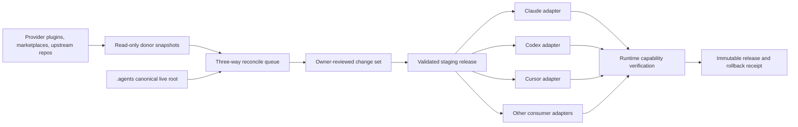

# Provider-neutral AI harness control plane

**Date:** 29.08.2026  
**Status:** Approved design; pending design-review gate  
**Canonical live root:** `C:\Users\Prekzursil\.agents`  
**Scope:** Claude Code, Codex, Cursor, Goose, Grok, Gemini CLI, Antigravity,
OpenCode, Fabric, Aider, and a later Hermes Agent canary

## 1. Goal

Create one provider-neutral control plane for the owner's AI tool estate without
silently removing capabilities, copying secrets into managed artifacts, or
allowing provider marketplaces and runtime-specific profiles to become competing
sources of truth.

The control plane governs:

- skills and command aliases;
- MCP definitions, health policy, and per-consumer exposure;
- rules and behavior pointers;
- hooks and enforcement classifications;
- semantic-memory authority and cache boundaries;
- native plugin dependencies;
- donor provenance and update reconciliation;
- consumer-specific generated configuration;
- runtime verification, rollback, and release receipts;
- periodic metadata-only discovery of candidate skills and MCPs.

## 2. Binding decisions

1. `C:\Users\Prekzursil\.agents` remains the live harness-at-root and canonical
   control-plane root.
2. `C:\Users\Prekzursil\AGENTS.md` remains the behavior contract.
3. `C:\Users\Prekzursil\.agents\skills` remains the canonical skill vault.
4. Basic Memory remains the canonical semantic-memory writer.
5. Provider-native memories may remain only as isolated caches. Promotion of a
   durable fact must pass through Basic Memory.
6. Provider-native plugins that cannot be ported may remain as declared
   dependencies with capability tests and a fallback.
7. Provider marketplaces, plugin stores, repositories, and registries are donor
   and discovery sources, never runtime authority.
8. Upstream updates never overwrite customized assets automatically. Every
   customized update is a three-way reconciliation.
9. No credential, token, key, or session is rotated. Existing sessions are
   preserved.
10. No capability is silently removed or downgraded. Every intentional loss
    requires an impact report and owner decision.
11. Discovery may create candidate reports only. It may not install, execute,
    enable, or promote candidates.
12. Hermes may become the preferred execution front end or scheduler after a
    canary, but it never owns canonical policy or state.

## 3. Evidence that motivates the design

### 3.1 Authority and deployment drift

- Live `.agents` and `source\agent-skills-toolchain` are independent dirty
  clones on different branches.
- A third toolchain clone and many scratch clones create provenance ambiguity.
- The live and repository harness copies differ materially.
- Repository `scripts\sync-skills.ps1` explicitly removes and recopies each
  target skill and may prune unmatched skills.
- `sync_shared_state.ps1` validates and publishes MCP views, then merges only
  Claude, Codex, and Cursor. It does not deploy rules or other consumers.

### 3.2 Skills, rules, and command drift

- The canonical vault has roughly 374 skill directories, while provider plugin
  and marketplace trees expose many additional overlapping skills.
- The deployed skill manifest covers only a minority of the live vault.
- `.agents\rules` is currently gitignored and incomplete, while the Claude rule
  tree is materially larger.
- The Codex rule tree contains duplicated hierarchy.
- `source-command-rules-distill` points to a missing full `rules-distill`
  workflow.
- Requested names such as `create-workflow`, `agents-dashboard`, `mcps`, and
  `harness-audit` do not consistently resolve to canonical skills even though
  neighboring implementations exist.

### 3.3 MCP drift

- `agents.json` currently validates only `claude` and `codex` targets.
- Cursor is a hard-coded filtered Claude projection with a six-server keep-list,
  not a first-class target.
- Claude, Codex, Grok, Gemini, Goose, and other consumers retain manual or
  plugin-provided MCP surfaces outside the registry.
- A Claude HTTP renderer test fails because the rendered entry omits the
  required transport type.
- Antigravity has experienced BOM-related configuration failure.

### 3.4 Enforcement and telemetry drift

- Claude, Codex, and Cursor use different hook stacks.
- Several controls are prompt-only, shadow, advisory, or opt-in.
- Cursor loggers persist command excerpts or full hook payloads without shared
  structural redaction, locking, rotation, or retention.
- Large terminal and hook JSONL files contain malformed or failed records.
- The deployment baseline is stale or shapeless, and missing baseline state can
  appear healthy.
- Presence-based harness scores do not establish runtime behavior.
- Codex contains `git-always-force-push=true`, which conflicts with the binding
  safety contract.

### 3.5 Memory drift

- Basic Memory is contractually canonical, but Claude plugin paths, Codex native
  memories, Gemini memory MCP, checkpoints, spools, and session digests create
  competing persistence.
- Session-start digest selection does not consistently preserve poison,
  supersession, project, and freshness controls.
- Basic Memory returned both a timeout and a session error during this audit.

## 4. Architecture

### 4.1 Canonical state

The canonical root contains:

- existing `agents.json` MCP registry for backward compatibility;
- one provider-neutral consumer and asset manifest;
- canonical skill/rule/hook/module implementations;
- asserted safety policies;
- provenance lock records for imported assets;
- adapter code and adapter conformance tests;
- workflow definitions and verification contracts.

Runtime logs, staging output, deploy backups, session data, and generated
consumer views remain local and gitignored.

### 4.2 Asset provenance

Every imported asset records:

- canonical identifier and asset class;
- original source and original provider;
- source revision/version and content hash;
- license and maturity status;
- last imported upstream hash;
- current canonical local hash;
- local customization status;
- security/review status;
- supported consumers and capability requirements;
- review date and update policy.

### 4.3 Three-way reconciliation

For an upstream update:

1. retrieve metadata and content into quarantine;
2. compare the last imported upstream base with the new upstream content;
3. compare the same base with the current customized canonical content;
4. auto-classify only:
   - upstream-only change;
   - local-only change;
   - identical change;
   - true conflict;
5. render a bounded review artifact;
6. require explicit approval for every conflict or capability-impacting change;
7. promote only the reviewed result.

Generated consumer output is never accepted as an upstream source.

### 4.4 Consumer capability manifest

For every consumer and asset class, record one of:

- `native`
- `emulated`
- `advisory`
- `unsupported`
- `not-tested`

Each consumer also declares:

- actual Windows configuration path;
- format, schema, encoding, and BOM policy;
- managed and unmanaged sections;
- native marketplace/plugin behavior;
- secret-reference syntax;
- approval and hook semantics;
- skill/rule size and discovery limits;
- MCP transport and resource limits;
- reload/restart behavior;
- runtime smoke command;
- rollback method.

Behavioral parity is never inferred from file presence.

## 5. Adapter contract

Every adapter implements:

1. `discover` — locate the installed consumer and active config.
2. `inventory` — return a redacted structural inventory.
3. `render` — create native output in staging.
4. `validate` — parse and schema-check staged output.
5. `diff` — show managed changes and preserved unmanaged state.
6. `apply` — atomically activate the staged view.
7. `verify` — execute a consumer-native smoke journey.
8. `rollback` — restore the prior verified release.

Unknown fields are preserved and reported. Unsupported required semantics stop
the adapter; they are never omitted silently.

## 6. Policy and secret handling

### 6.1 Managed settings

Consumer configuration is split into:

- canonical managed settings;
- asserted safety settings;
- preserved native settings;
- credential/session material that adapters may reference but never copy into
  canonical state.

An asserted safety setting may reject a contradictory native value such as
automatic force-push. It must produce an impact diff before any change.

### 6.2 Secret rules

- Canonical files contain symbolic environment/keyring references only.
- Logs, diffs, diagnostics, backups, and receipts are redacted before storage.
- Credential-bearing files are not copied into Git or model context.
- Existing credential values and sessions are not rotated.
- Mixed config/auth files use structural managed-region edits.
- Protected rollback copies remain local, access-controlled, bounded, and
  retention-limited.

## 7. Memory and persistence classes

| Class | Canonical owner | Other consumers |
|---|---|---|
| Durable semantic facts | Basic Memory | Read/cache; publish only through Basic Memory |
| Objective event history | Event ledger | Read-only views |
| Active goal/resume state | Project execution state | Provider adapters may mirror |
| Session history | Native runtime | Non-canonical |
| Checkpoints | Native/project recovery | Non-semantic, bounded |
| Telemetry/logs | Shared redacted logger | Bounded, rotated |

When Basic Memory is unavailable, the harness reports degraded state and uses
bounded non-authoritative cache data. It does not silently promote cache content
to durable memory.

## 8. Plugins and marketplaces

Each plugin is classified:

1. fully vendorable skill/MCP/rule content;
2. adapter-dependent native capability;
3. irreducible native dependency;
4. discovery-only donor;
5. rejected/quarantined.

No plugin is disabled until its capabilities are inventoried and equivalent
held-out journeys pass or the owner approves the loss.

## 9. Compatibility command layer

Thin aliases preserve familiar commands without duplicating implementation:

| Requested name | Canonical implementation |
|---|---|
| `harness-audit` | executable audit runner and runtime eval report |
| `rules-distill` | repaired canonical rule-distillation workflow |
| `create-workflow` | `workflow-authoring` |
| `agents-dashboard` | monitorcore/workflow-monitor |
| `mcps` | MCP control-plane and fleet-curation router |
| DataRobot external monitoring | donor pattern pending evidence/adoption |

Alias skills contain pointers and compatibility metadata only.

## 10. Hermes decision

Hermes is **Hermes-capable, not Hermes-dependent**.

Official evidence as of 29.08.2026:

- native Windows 10/11 support;
- MIT license;
- active v0.20.6 release dated 27.08.2026;
- stdio and HTTP MCP support;
- Agent Skills support;
- preview-first Claude/Codex import;
- TUI, dashboard, messaging gateway, cron, subagents, sandboxing, hooks, and
  plugins;
- pre-tool hooks can block or request approval;
- native memory-provider plugin interface.

Risks:

- imports copy skills, instructions, MCPs, and memory into Hermes-owned paths;
- Hermes owns separate config, skills, memory, plugins, sessions, and logs;
- rapid pre-1.0 release cadence increases adapter churn;
- parallel subagents can collide in a shared persistent container;
- Hermes-native memory conflicts with the canonical Basic Memory policy;
- a runtime takeover could become a de facto second SSOT.

Adoption:

1. no installation during initial reconciliation;
2. inspect/import commands remain dry-run-only;
3. build a loss-aware Hermes adapter from canonical state;
4. canary native Windows operation with isolated sessions/containers;
5. prove memory, policy, rollback, RAM, and capability journeys;
6. allow Hermes to become the preferred execution front end if evidence holds;
7. retain `.agents` and other native runtimes as the policy/recovery boundary.

Sources:

- <https://github.com/NousResearch/hermes-agent>
- <https://hermes-agent.nousresearch.com/docs/user-guide/windows-native>
- <https://hermes-agent.nousresearch.com/docs/user-guide/import-from-other-agents>
- <https://hermes-agent.nousresearch.com/docs/user-guide/features/mcp>
- <https://hermes-agent.nousresearch.com/docs/user-guide/features/hooks>
- <https://hermes-agent.nousresearch.com/docs/user-guide/security>
- <https://hermes-agent.nousresearch.com/docs/developer-guide/memory-provider-plugin>

## 11. Fabric decision

Fabric is a secondary prompt-pattern consumer, not a full agent runtime.

Verified 29.08.2026:

- Fabric `1.4.470`;
- 255 patterns;
- nine prompting strategies;
- direct `Gemini/gemini-3.1-pro-preview` default;
- a PowerShell wrapper isolates Fabric from the estate-wide ClawBay Gemini base
  URL while restoring the original environment after every call;
- argument, stdin pipeline, strategy, and live model journeys pass.

Fabric cannot natively consume the shared skill vault or MCPs. Its future
adapter generates a minimal context and verified defaults without pretending
to provide skill or MCP parity.

## 12. Rollout

### Phase 0 — freeze and reconcile evidence

- capture redacted inventories and hashes;
- classify every clone and runtime path;
- choose canonical content per conflicting asset;
- protect sessions and credential locations;
- prohibit destructive bulk skill sync.

### Phase 1 — safety and telemetry

- replace raw hook payload logging;
- add lock, rotation, retention, and dropped-write counters;
- repair stale/shapeless drift baselines;
- assert contradictory safety settings;
- distinguish tests from production telemetry.

### Phase 2 — Tier 1 adapters

- reconcile skills, rules, MCPs, hooks, and memory for Claude, Codex, Cursor;
- make Cursor a first-class consumer with an explicit six-MCP policy;
- fix Claude HTTP rendering;
- prove non-destructive, transactional activation and rollback.

### Phase 3 — installed secondary consumers

Add one adapter at a time:

1. Grok
2. Goose
3. Gemini CLI
4. Antigravity
5. OpenCode
6. Fabric
7. Aider

Each adapter requires a native parse/load/behavior smoke before the next begins.

### Phase 4 — Hermes canary

- install only after explicit approval;
- generate from canonical state;
- run isolated Windows canaries;
- compare execution reliability and resource cost;
- consider preferred-runtime graduation.

### Phase 5 — discovery and reconciliation

- periodically query vetted registries/marketplaces/repositories;
- fetch metadata before content;
- quarantine and grade candidates;
- deduplicate by capability and provenance;
- create a review queue only;
- reconcile approved updates without overwriting local work.

### Phase 6 — dashboard and recurring governance

- publish an honest capability/enforcement/health matrix;
- show drift, degraded states, receipts, and pending reconciliations;
- expose no secret values;
- schedule bounded audits, not broad recursive always-on scans.

## 13. Provider-neutral workflow

The large governance workflow is a thin orchestration layer over deterministic
control-plane commands. Core logic does not live in a Claude-only workflow.

Canonical phases:

1. `GROUND`
2. `INVENTORY`
3. `VERIFY`
4. `RECONCILE`
5. `REVIEW`
6. `STAGE`
7. `APPLY`
8. `RUNTIME_VERIFY`
9. `RECEIPT`
10. `DISCOVER`

Thin wrappers expose the same contract as:

- a Claude saved workflow;
- a Cursor command;
- a Codex orchestration prompt/command;
- a later Hermes job;
- manual `agents` CLI commands.

Default operation is audit/plan. `APPLY` requires an approved staged release.
Every phase writes a bounded resume artifact so interrupted runs continue from
the last disk-verified checkpoint.

## 14. Blocking evaluations

1. **Inventory detector:** fires on known-present and known-missing fixtures.
2. **Capability preservation:** no unexplained enabled skill/MCP/rule/hook/
   plugin loss.
3. **Secret safety:** synthetic credentials never reach generated configs,
   logs, diffs, backups, receipts, or model context.
4. **Schema and encoding:** native parser succeeds; UTF-8/BOM requirements hold.
5. **Round trip:** canonical-to-native-to-inventory loses no required field.
6. **Idempotence:** second render produces no diff.
7. **Transactional deployment:** fault injection at every stage restores the
   prior release.
8. **Runtime behavior:** installed consumer starts and exercises representative
   skill/MCP/rule/hook behavior.
9. **Policy conflict:** contradictory safety settings are detected before apply.
10. **Memory:** project isolation, supersession, poison resistance, outage
    degradation, and canonical publication.
11. **Logging:** concurrent append, redaction, rotation, retention, and
    malformed-input behavior.
12. **Resource limits:** no duplicate singleton services, no broad background
    clone scans, bounded RAM/process budget.
13. **Completion AND-gate:** exit zero, artifact exists, size/schema/sentinel
    validate, and no forbidden path changed.

## 15. Explicit non-goals

- identical tool inventories on every runtime;
- copying all Claude MCPs to Cursor or every secondary consumer;
- a second always-on orchestration daemon;
- automatic skill/MCP installation or adoption;
- automatic upstream overwrite of customized content;
- replacing every provider-native feature;
- disabling capabilities solely to simplify the design;
- rotating credentials;
- making Hermes, Claude, Codex, Cursor, or any marketplace the SSOT;
- treating file presence or agent self-report as proof of completion.

## 16. Design-review questions

The design-review gate must challenge:

1. whether `.agents` can remain live and canonical without a safer activation
   boundary;
2. whether the canonical manifest can preserve provider-specific semantics;
3. whether managed-region edits can preserve sessions and mixed secret/config
   files;
4. whether per-consumer rollout prevents capability loss;
5. whether Basic Memory cache policy remains useful during outages;
6. whether Hermes can be trialed without creating a second SSOT;
7. whether the workflow remains provider-neutral rather than Claude-specific;
8. whether the proposed system is smaller than the drift it replaces.

