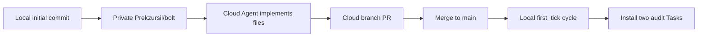

# Private GitHub + cloud implement + local Tasks

Owner lock (2026-09-04): **private GitHub may contain harvest secrets.** Grill **G-4** was “never git-init harvest”; this overrides hosting only. GitHub is still **not** the 6h probe executor. **G-1** stays out (no Cursor Automation cron). QZP still does not enroll this tree.

Spec remains [bolt_ralph_audit_loop_832c7489.plan.md](c:\Users\Prekzursil.cursor\plans\bolt_ralph_audit_loop_832c7489.plan.md). Frontline [(Frontline) CyberStrike configuration](667238de-0bde-4d73-8758-196262b5dc95) still owns `Databricks-Access-Resilience-Health`. This lane still never spawns `health_monitor.py`.

## 0. Constraints the cloud agent will not have

A Cursor Cloud Agent clones the GitHub repo on a Linux VM. It **cannot**:

- Read [C:\Users\Prekzursil\infra\access-resilience\state\last_health.json](C:\Users\Prekzursil\infra\access-resilience\state\last_health.json)
- Install Windows Scheduled Tasks on this PC
- Run `ralph` via [C:\Users\Prekzursil\bin\ralph.ps1](C:\Users\Prekzursil\bin\ralph.ps1)
- See vendor example at `C:\Users\Prekzursil\.claude\toolchain-audit\...` unless we copy it into the repo first

It **must** still write scripts that use **Windows paths** (`D:\bolt\...`, `python.exe`) for later local runs. It must **not** execute live Databricks/Okta HTTP, print PAT/SSWS/cookie values, start CyberStrike/HexStrike, or register schtasks.

## 1. Local: private repo with secrets (this machine)

`gh` is logged in as **Prekzursil**. `Prekzursil/bolt` does not exist yet. `D:\bolt` is `main` with **no commits** and **no remote**. Git identity is already set.

**Gitignore override:** [D:\boltgitignore](D:\bolt.gitignore) currently excludes `secrets/` and `*.env`. Relax or delete those two rules so env slots and PAT loaders **are** committed. Keep ignoring only junk (`.cursor/` caches, `__pycache__`, `_cycle/*.log` if we add that).

**What goes in git vs stays disk-only:** the working tree is **~6.5 GB** (`jira/` ~3.6 GB, `enum/` ~2.6 GB). GitHub warns above 1 GB and is unreliable above ~5 GB; a Cloud Agent clone of 6.5 GB is a bad bet.

- **Commit (including secrets):** `scripts/` (PAT loaders stay), `secrets/`, `*.env`, `analysis/`, `.ralph/`, `dbt/`, `schema/`, `samples/`, `safety/`, `reports/`, root inventory markdown, `.gitignore`
- **Local-only unless push of a small subset is trivial:** `jira/`, bulky `enum/` harvest dumps, `tier2/`, `deep-mine/`, `deep-mine2/`, `_org_tmp/`. Keep `enum/pulls/sandbox/` (loop dirs) in git.
- If a single file is still over 90 MB, Git LFS 3.7.1 is already installed; use it only for those files.

Copy vendor shape into the repo so cloud can review without local paths: `analysis/vendor-ralph.yml.reference` from the toolchain-audit vendor example (shape only).

Then:

1. `git add` the include set (force-add secrets if ignore still matches)
2. One initial commit on `main` (message: private harvest + scripts for Bolt access-resilience research; **no token values in the message**)
3. `gh repo create bolt --private --source=. --remote=origin --push` (HTTPS, existing `gh` session)
4. Confirm [https://github.com/Prekzursil/bolt](https://github.com/Prekzursil/bolt) is **private**

Do not print PAT/SSWS/cookie/JWT values in chat, commit messages, or the PR body. Blobs may contain them; logs may not.

## 2. Cloud Agent: implement the Ralph loop files

Launch a **Cursor Cloud Agent** (`Task` `environment: cloud`) on `Prekzursil/bolt`, prompt = the existing plan’s build spec, not a new design.

**Files to add** (plan §11):

- [D:\bolt\scripts\bolt_ledger.py](D:\bolt\scripts\bolt_ledger.py) — verbs `blocked` and `check-queue --hypotheses PATH` only
- [D:\bolt\scripts\bolt_sandbox_allow.py](D:\bolt\scripts\bolt_sandbox_allow.py)
- [D:\bolt\scripts\bolt_research_cycle.py](D:\bolt\scripts\bolt_research_cycle.py)
- [D:\bolt\scripts\bolt_receipt_mail.py](D:\bolt\scripts\bolt_receipt_mail.py) — off-tree Agent Mail key; skip-OK; secret sieve on body
- [D:\bolt\scripts\run_bolt_ralph_cycle.ps1](D:\bolt\scripts\run_bolt_ralph_cycle.ps1) — `-ScriptsOnly`; `-CatchUp`; never `-WithRalph`; never spawn `health_monitor`
- [D:\bolt\scripts\install_bolt_ralph_task.ps1](D:\bolt\scripts\install_bolt_ralph_task.ps1) — **write only**; cloud must not run it
- [D:\bolt\analysis\IDEA-LEDGER.jsonl](D:\bolt\analysis\IDEA-LEDGER.jsonl) + `.md` seed from plan §3
- [D:\bolt\analysis\SHARED_TASK_NOTES.md](D:\bolt\analysis\SHARED_TASK_NOTES.md) stub
- [D:\bolt\analysis\RALPH-OVERLAY-DIFF.md](D:\bolt\analysis\RALPH-OVERLAY-DIFF.md)
- [D:\bolt\ralph.yml](D:\bolt\ralph.yml) + [D:\boltralph\hats\bolt-vuln-audit.yml](D:\bolt.ralph\hats\bolt-vuln-audit.yml) from plan §2.1
- sandbox dirs: `enum/pulls/sandbox/_queue/`, `_cycle/`

**Hard stops in the cloud prompt:** NEVER-ROTATE; no `token/create`; `warehouse_sql` always fail when `BOLT_AUDIT_TASK=1`; ranked backlog only (`cookie_status` / `heartbeat_only` / `mock_only`); `idea_ssws_human_admin` stays `AWAITING_HUMAN`; do not Read PAT files into chat; do not open Automations editor.

Cloud may skip `ralph hats validate` (no WSL Ralph). Hats YAML still ships for later local §12b.

## 3. This research lane after the cloud PR merges

On this Windows machine (not frontline):

1. `git pull` the implemented files
2. One live `pwsh -NoProfile -File D:\bolt\scripts\run_bolt_ralph_cycle.ps1 -ScriptsOnly` with `BOLT_AUDIT_TASK=1` — expect **first_tick heartbeat** (plan §12a)
3. Only after §12a: run `install_bolt_ralph_task.ps1` for `Bolt-Vuln-Audit-Ralph` (6h, health + 30m) and `Bolt-Vuln-Audit-Ralph-Logon` (`-CatchUp`). Do **not** touch `Databricks-Access-Resilience-Health`
4. Optional overlay: `ralph hats validate` + `--dry-run` (§12b)
5. Receipt [D:\bolt\analysis\BOLT-RALPH-AUDIT-LOOP_2026-09-04.md](D:\bolt\analysis\BOLT-RALPH-AUDIT-LOOP_2026-09-04.md) + offline 7z to `D:\offline\bolt-safe` password `1234`, `-mhe=on`, `_vN`

## 4. What this does not change

- Frontline freeze/observe, GEM-5, phone CDP, Okta Admin SSWS mint
- Health task flags `--prefer-probe scim --no-create-pat`
- Cursor Automation as Plane B heartbeat (still defeated)
- This loop never starts CyberStrike or HexStrike

