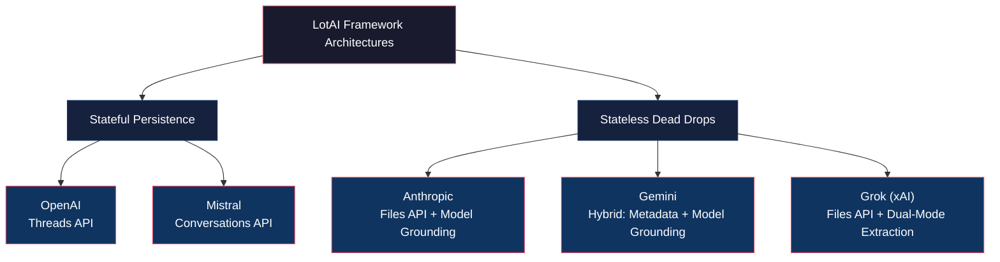

# RedBeacon AI: LLM-Powered Red Team Signals

```
██████╗ ███████╗██████╗ ██████╗ ███████╗ █████╗  ██████╗ ██████╗ ███╗   ██╗
██╔══██╗██╔════╝██╔══██╗██╔══██╗██╔════╝██╔══██╗██╔════╝██╔═══██╗████╗  ██║
██████╔╝█████╗  ██║  ██║██████╔╝█████╗  ███████║██║     ██║   ██║██╔██╗ ██║
██╔══██╗██╔══╝  ██║  ██║██╔══██╗██╔══╝  ██╔══██║██║     ██║   ██║██║╚██╗██║
██║  ██║███████╗██████╔╝██████╔╝███████╗██║  ██║╚██████╗╚██████╔╝██║ ╚████║
╚═╝  ╚═╝╚══════╝╚═════╝ ╚═════╝ ╚══════╝╚═╝  ╚═╝ ╚═════╝ ╚═════╝ ╚═╝  ╚═══╝
```

## Overview

A research tool built to simulate and audit covert data transport channels operating over trusted enterprise AI platform APIs. By manipulating legitimate provider architectures, RedBeacon AI demonstrates how logic abuse can turn standard cloud APIs into a serverless, bidirectional communication layer that blends seamlessly into allowlisted network traffic.

RedBeacon currently supports five major AI platforms: **OpenAI** (Threads API with Fernet encryption), **Anthropic** (Files API with Base64 encoding), **Google Gemini** (Files API with disguised filenames), **Mistral AI** (Conversations API with agent-based channels), and **xAI Grok** (Files API with dual-mode extraction). Each channel uses different techniques to hide commands and exfiltrate data through legitimate API calls.

---

## Supported Channels

| Provider | API Type | Encoding | Transport Method |
|----------|----------|----------|------------------|
| **OpenAI** | Threads API (Stateful) | Fernet Encryption | Thread ID as dead-drop |
| **Anthropic** | Files API | Base64 | UUID-based file naming |
| **Gemini** | Files API | Base64 | Disguised system filenames |
| **Mistral** | Conversations API | Base64 | Agent-based message channels |
| **Grok (xAI)** | Files API (Stateless) | Base64 | Dual-mode: Direct Download + Model Grounding |

---

## Architecture



### Platform Comparison Matrix

| Aspect | OpenAI | Anthropic | Gemini | Mistral | Grok (xAI) |
|---|---|---|---|---|---|
| **API Type** | Threads API (Assistants) | Files API (Beta) | Files API (Hybrid) | Conversations API | Files API (Dual-Mode) |
| **Architecture** | STATEFUL | STATELESS | STATELESS | STATEFUL | STATELESS |
| **Dead Drop** | Thread ID | File Storage | File Metadata + Content | Conversation ID | File Storage |
| **State Owner** | Provider (server-side) | None (client polls) | None (client polls) | Provider (server-side) | None (client polls) |
| **Encoding** | Fernet Encryption | Base64 | Base64 | Base64 | Base64 |
| **Command Format** | `CMD:{encrypted}` | `cmd_{uuid}.txt` (file) | `cmd_{base64}` (display_name) | `CMD:{base64}` | `cmd_{uuid}.txt` (file) |
| **Response Format** | `RES:{encrypted}` | `res_{uuid}.txt` (file) | `RESPONSE_DATA:{b64}` (content) | `RES:{base64}` | `res_{uuid}.txt` (file) |
| **Polling Method** | `messages.list(limit=1)` | `files.list()` | `files.list()` | `GET /conversations/{id}/messages` | `files.list()` |
| **RAG/Grounding** | No | Yes — LLM reads file | Hybrid — Metadata + LLM | No | Dual — Direct download OR LLM grounding |
| **Token Cost** | Minimal (message storage) | Per extraction call | Commands: 0 tokens; Responses: per call | Minimal (message storage) | Direct: 0 tokens; Grounding: per call |

---

## Installation

### Prerequisites
- Python 3.9+
- API keys for the AI platforms you want to use

### Step 1: Install uv (Fast Python Package Manager)

**macOS/Linux:**
```bash
curl -LsSf https://astral.sh/uv/install.sh | sh
```

**Windows (PowerShell):**
```powershell
powershell -ExecutionPolicy ByPass -c "irm https://astral.sh/uv/install.ps1 | iex"
```

### Step 2: Clone & Setup Virtual Environment
```bash
# Navigate to project directory
cd RedBeacon-AI

# Create virtual environment
uv venv

# Activate virtual environment
# macOS/Linux:
source .venv/bin/activate

# Windows:
.venv\Scripts\activate
```

### Step 3: Install Dependencies
```bash
uv pip install openai anthropic google-genai mistralai xai-sdk cryptography requests
```

Or using pip:
```bash
pip install -r requirements.txt
```

---

## Configuration

RedBeacon uses a hybrid configuration system:

1. **First Run**: You'll be prompted for API keys (masked input)
2. **Auto-Save**: Keys are saved to `.env` file automatically
3. **Future Runs**: Keys are loaded from `.env` (no prompts)

### API Keys Required

| Channel | Required Keys |
|---------|---------------|
| OpenAI | `OPENAI_API_KEY`, `OPENAI_ENCRYPTION_KEY` (auto-generated) |
| Anthropic | `ANTHROPIC_API_KEY` |
| Gemini | `GEMINI_API_KEY` |
| Mistral | `MISTRAL_API_KEY`, `MISTRAL_AGENT_ID` |
| Grok (xAI) | `XAI_API_KEY` |

### Key Rotation (Optional)

To manually rotate the Fernet encryption key for OpenAI:
```bash
python -c "from cryptography.fernet import Fernet; print(Fernet.generate_key().decode())"
```
> **Note:** Update both attacker and implant `.env` files with the new key.

---

## Usage

### Interactive Menu
```bash
python redbeacon.py
```

This launches the main menu where you can:
- Select a communication channel (OpenAI, Anthropic, Gemini, Mistral, Grok)
- Choose to run as **Attacker (C2 Controller)** or **Victim (Implant)**

### Direct Module Access

**C2 Controller (Attacker Side):**
```bash
python openai_c2/c2.py
python anthropic_c2/c2.py
python gemini_c2/c2.py
python mistral_c2/c2.py
python grok_c2/c2.py
```

**Implant (Victim Side):**
```bash
python openai_c2/implant.py
python anthropic_c2/implant.py
python gemini_c2/implant.py
python mistral_c2/implant.py
python grok_c2/implant.py
```

---

## Workflow Example (Gemini C2)

**1. Attacker Side:**
```bash
python gemini_c2/c2.py
# Enter Gemini API key when prompted (first run only)
# Type commands at C2_Shell> prompt
```

**2. Victim Side (separate machine):**
```bash
python gemini_c2/implant.py
# Uses same API key
# Auto-polls for commands and sends back results
```

---

## Project Structure

```
RedBeacon-AI/
├── redbeacon.py          # Main interactive launcher
├── config.py             # Hybrid configuration (env + interactive)
├── utils.py              # Encoding/decoding helpers
├── requirements.txt      # Python dependencies
├── .env                  # API keys (auto-created, gitignored)
├── .gitignore            # Excludes secrets and temp files
│
├── openai_c2/
│   ├── __init__.py
│   ├── c2.py             # C2 Controller (Fernet encrypted)
│   └── implant.py        # Victim implant
│
├── anthropic_c2/
│   ├── __init__.py
│   ├── c2.py             # C2 Controller (Files API)
│   └── implant.py        # Victim implant
│
├── gemini_c2/
│   ├── __init__.py
│   ├── c2.py             # C2 Controller (Files API)
│   └── implant.py        # Victim implant
│
├── mistral_c2/
│   ├── __init__.py
│   ├── c2.py             # C2 Controller (Conversations API)
│   └── implant.py        # Victim implant
│
└── grok_c2/
    ├── __init__.py
    ├── c2.py             # C2 Controller (xAI Files API, Dual-mode)
    └── implant.py        # Victim implant
```

---

## Security Considerations

- `.env` file is gitignored to prevent accidental key exposure
- API keys are entered via masked input (like passwords)
- OpenAI channel uses Fernet symmetric encryption
- Other channels use Base64 encoding (obfuscation, not encryption)

---

## Disclaimer

> ⚠️ **This tool is for authorized security testing and educational research only.**
> 
> Do not use RedBeacon for malicious purposes. Unauthorized access to computer systems is illegal. Always obtain proper authorization before conducting security assessments.

---

## License

MIT License

---

## Author

Built for red team research and AI security exploration by CyberWarFare Labs [https://cyberwarfare.live]
