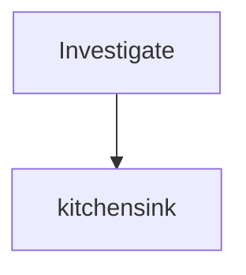

# wfmon-export-fixture (`wf_export00-fixture`)

> **redaction: strict** - 0 masked

> ⚠ run still active - snapshot only (data may be incomplete)

**Agents:** 1 total - 1 done - 0 error - 0 running - 0 idle - 1,000 tokens

## Contents

- [Investigate](#phase-1)
  - [kitchensink](#agent-kitchensink)

## Fan-out



_Text fallback:_
```
Investigate
└─ kitchensink [done]
```

## <a id="phase-1"></a>Investigate

### <a id="agent-kitchensink"></a>kitchensink - done
`claude-opus-4-8[1m]` - 1,000 tokens - 4 tool calls
_Kitchensink Report_

**Task:**
> Do the kitchen-sink task.

**Transcript:**

```
Do the kitchen-sink task.
```

*thinking:*

```
Let me reason about the kitchen sink carefully.
```

```
Here is my plan.
```

<details>
<summary>🔧 Bash</summary>

Input:
```
{
  "command": "ls -la"
}
```

Output:
```
total 0
drwxr-xr-x  2 user user
```
</details>

<details>
<summary>🔧 web_search</summary>

Input:
```
{
  "query": "kitchen sink"
}
```

Output:
```
search result A
search result B
```
</details>

<details>
<summary>🔧 Read</summary>

Input:
```
{
  "file_path": "missing.txt"
}
```

_(no result)_
</details>

<details>
<summary>🔧 Grep - error</summary>

Input:
```
{
  "pattern": "boom"
}
```

Output:
```
{"error": "boom", "code": 2}
```
</details>

```
after the image
```

**Output:**
```
# Kitchensink Report
All transcript block kinds are covered by this fixture.
```
