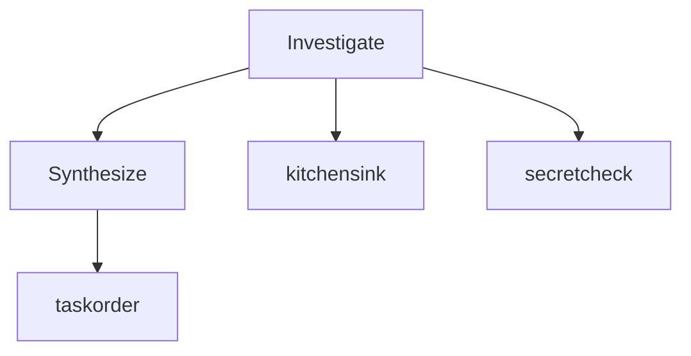

# wfmon-export-fixture (`wf_export00-fixture`)

> **redaction: strict** - 28 masked

> ⚠ run still active - snapshot only (data may be incomplete)

**Agents:** 3 total - 1 done - 1 error - 1 running - 0 idle - 1,750 tokens

## Contents

- [Investigate](#phase-1)
  - [kitchensink](#agent-kitchensink)
  - [secretcheck](#agent-secretcheck)
- [Synthesize](#phase-2)
  - [taskorder](#agent-taskorder)

## Fan-out



_Text fallback:_
```
Investigate
├─ kitchensink [done]
└─ secretcheck [error]
Synthesize
└─ taskorder [running]
```

## <a id="phase-1"></a>Investigate

### <a id="agent-kitchensink"></a>kitchensink - done
`claude-opus-4-8[1m]` - 1,000 tokens - 4 tool calls
_Kitchensink Report_

**Task:**
> Do the kitchen-sink task.

**Transcript:**

```
Do the kitchen-sink task.
```

*thinking:*

```
Let me reason about the kitchen sink carefully.
```

```
Here is my plan.
```

<details>
<summary>🔧 Bash</summary>

Input:
```
{
  "command": "ls -la"
}
```

Output:
```
total 0
drwxr-xr-x  2 user user
```
</details>

<details>
<summary>🔧 web_search</summary>

Input:
```
{
  "query": "kitchen sink"
}
```

Output:
```
search result A
search result B
```
</details>

<details>
<summary>🔧 Read</summary>

Input:
```
{
  "file_path": "missing.txt"
}
```

_(no result)_
</details>

<details>
<summary>🔧 Grep - error</summary>

Input:
```
{
  "pattern": "boom"
}
```

Output:
```
{"error": "boom", "code": 2}
```
</details>

```
after the image
```

**Output:**
```
# Kitchensink Report
All transcript block kinds are covered by this fixture.
```

### <a id="agent-secretcheck"></a>secretcheck - error
`claude-opus-4-8[1m]` - 500 tokens - 1 tool calls - attempt 2
_FAKE credentials for redaction tests (all synthetic, non-functional):_

**Task:**
> Audit this text for secrets and home paths.

**Transcript:**

```
Audit this text for secrets and home paths.
```

```
FAKE credentials for redaction tests (all synthetic, non-functional):
api-key: [REDACTED:api-key]
gh-pat: [REDACTED:gh-pat]
gh-fine: [REDACTED:gh-pat]
aws: [REDACTED:aws-akid]
slack: [REDACTED:slack]
gh-oauth: [REDACTED:gh-token]
jwt: Bearer [REDACTED:jwt]
pem: [REDACTED:pem-private-key]
benign-jwt-lookalike: abcdef...not.a.jwt.value
gitcrypt: [REDACTED:gitcrypt-key]
home-win: ~\Documents\notes.txt
home-fwd: ~/Documents/notes.txt
home-gitbash: ~/work/file
home-wsl: ~/work/file
home-83: ~\Local\cache
```

**Output:**
```
FAKE credentials for redaction tests (all synthetic, non-functional):
api-key: [REDACTED:api-key]
gh-pat: [REDACTED:gh-pat]
gh-fine: [REDACTED:gh-pat]
aws: [REDACTED:aws-akid]
slack: [REDACTED:slack]
gh-oauth: [REDACTED:gh-token]
jwt: Bearer [REDACTED:jwt]
pem: [REDACTED:pem-private-key]
benign-jwt-lookalike: abcdef...not.a.jwt.value
gitcrypt: [REDACTED:gitcrypt-key]
home-win: ~\Documents\notes.txt
home-fwd: ~/Documents/notes.txt
home-gitbash: ~/work/file
home-wsl: ~/work/file
home-83: ~\Local\cache
```

## <a id="phase-2"></a>Synthesize

### <a id="agent-taskorder"></a>taskorder - running
`claude-opus-4-8[1m]` - 250 tokens - 0 tool calls
_working on the ordered task_

**Task:**
> short task

**Transcript:**

```
short task
```

```
working on the ordered task
```

```
This is a much larger later user message that must NOT be selected by agent_task, because agent_task returns the FIRST user message that carries text (the spawn prompt), not the largest one the way agent_prompt does. It is padded well past the length of the short first message so that a max-by-length selector would wrongly prefer it, which is exactly the regression this taskorder fixture pins against.
```

**Output:**
```
working on the ordered task
```
