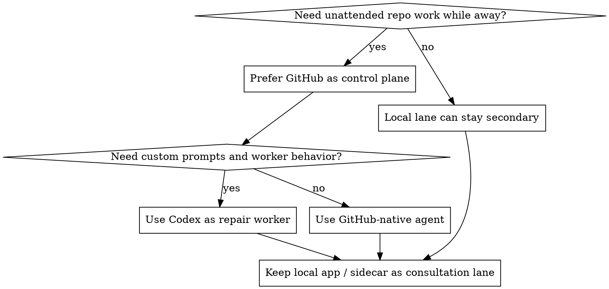

# Quality Gate Automation Architect

## Overview

Design safe, bounded automation systems for repo quality work. Prefer short, auditable loops with explicit stop rules over long-lived "super-agent" flows that mix repair, debt cleanup, and merge policy into one opaque process.

## Reference Map

- Read [references/github-control-plane.md](references/github-control-plane.md) when GitHub is or should be the control plane.
- Read [references/openai-codex-workers.md](references/openai-codex-workers.md) when Codex is a candidate worker or the user mentions Codex app, Codex Cloud, `codex exec`, or `openai/codex-action`.
- Read [references/analyzers-and-gates.md](references/analyzers-and-gates.md) when coverage, SonarQube Cloud, Codacy, Codecov, or branch-protection quality gates are involved.
- Read [references/local-consult-lane.md](references/local-consult-lane.md) when a local agent sidecar, local schedulers, VS Code sidecars, or Codex app automations are part of the design.
- Read [references/evidence-refresh.md](references/evidence-refresh.md) when the user wants the skill or references to absorb recurring lessons from prior sessions or repos.

## Workflow Decision

## Required Discovery

Before proposing architecture, inspect or establish these facts:

1. Current control plane: GitHub Actions, hosted agent, local scheduler, Codex app automation, or mixed.
2. Current signal producers: tests, coverage, lint, security scans, SonarQube Cloud, Codacy, Codecov, visual checks, deployment checks.
3. Current merge policy: branch protection, rulesets, required approvals, merge queue, zero-touch tolerance.
4. Mutation surfaces: which actor is allowed to edit code, rerun checks, update branches, or merge.
5. Scope split: whether historical debt is separate from pull-request repair.

Ask follow-up questions only for high-impact intent that cannot be discovered:

- What outcome is primary: PR rescue, coverage ratchet, debt reduction, or governance design?
- Is true unattended behavior required, or is a consultation lane acceptable?
- Is human-approved merge mandatory?
- Are there explicit "never touch" areas such as auth, security, infra, migrations, or release branches?

Ask one question at a time.

## Required Comparison

Always compare these three backbones, even if one is obviously favored:

### 1. GitHub-native agent

Use when GitHub should own the control plane and the user wants the most reliable unattended path. Emphasize governance, branch protection, PR workflow fit, and built-in review requirements.

### 2. OpenAI-first Codex

Use when the worker needs tighter prompt control, custom repair policies, or consistent behavior across CLI, app, and CI. Emphasize that GitHub can still remain the control plane while Codex is the repair worker.

### 3. Local-first hybrid

Use when the user needs rich local context, local sidecar consultation, or local-only tools. Keep it secondary unless the user explicitly accepts machine-uptime dependency and sidecar fragility.

State which lane is primary, which lanes are secondary, and why.

## Required Lane Separation

Never collapse these into one generic loop:

- `PR repair lane`: make required checks green on the current PR head SHA.
- `Coverage ratchet lane`: raise or preserve coverage with narrow, test-led changes.
- `Analyzer debt burn-down lane`: reduce historical Sonar or Codacy backlog in small reviewable batches.
- `Consultation lane`: explain blocked cases, classify failures, or design next steps without becoming the main unattended executor.

Only let historical debt enter the PR repair lane when the failing PR explicitly requires it.

## Required Guardrails

Every plan must make concrete decisions for:

- concurrency per PR or branch
- retry budget
- stop-on-no-progress rule
- stale-head-SHA behavior
- diff size or file scope caps
- allowed production edits versus test-only preference
- flaky or external provider handling
- zero-touch versus human-approved merge
- audit trail and status reporting

Default recommendations unless the user overrides them:

- human-approved merge
- one bounded attempt per failure classification before escalation
- separate coverage work from lint or analyzer debt work
- prefer targeted tests over production refactors
- stop with `success`, `partial`, or `blocked`

## Output Contract

Return a complete playbook with these sections:

1. `recommendation`
2. `option_comparison`
3. `architecture`
4. `workflow_outline`
5. `prompt_patterns`
6. `guardrails`
7. `rollout_phases`
8. `risks`
9. `validation_plan`

If the user asks casually, the sections can be prose instead of literal JSON keys, but all nine elements must still be present.

## Prompt Patterns

Reuse and adapt these defaults:

### PR repair

`Read the current failing required checks, CI logs, and provider statuses for this PR. Goal: make the required checks on the latest head SHA pass. Make the smallest high-confidence changes necessary. Keep work scoped to the failing lane. Re-run the smallest relevant verification. Stop if the next step needs broader refactoring or if no meaningful progress is possible.`

### Coverage ratchet

`Read the PR diff and coverage report. Prefer targeted tests in already-touched code. Avoid broad refactors. Allow only tiny seam changes when behavior-preserving. Stop as soon as the ratchet target is met or the next gain would require broader production changes.`

### Analyzer debt burn-down

`Fix one rule family in one subsystem. Keep the batch reviewable. Do not mix coverage work, dependency updates, or unrelated cleanup. Stop when the batch crosses behavioral boundaries or when reviewer-only judgment is required.`

## Red Flags

These patterns should trigger pushback:

- "Make everything 100% and zero issues forever" as one loop
- whole-repo historical debt mixed into every PR rescue run
- zero-touch merge without proven low-risk rule allowlists
- acting on stale or obsolete status contexts without checking the true producer
- local sidecars or app automations used as the primary unattended backbone without acknowledging uptime and state drift risks
- prompts that permit unrelated refactors or undefined success conditions

## Common Mistakes

- Treating provider dashboards as the only source of truth instead of checking branch protection, rulesets, and actual workflow producers.
- Using one retry loop for unrelated failure lanes such as coverage, lint, infra, and visual tests.
- Designing prompts around "fix everything" instead of a bounded unit of work.
- Assuming local automation equals remote unattended execution.
- Offering architecture without a rollout and validation plan.