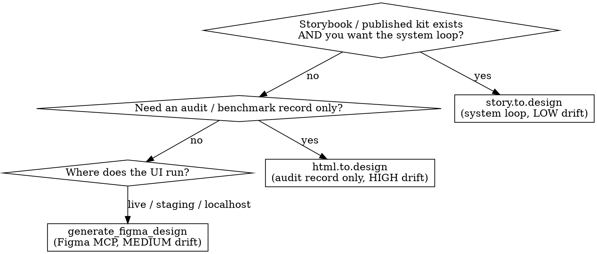

<!-- origin: user (design-SOTA research, 2026-06-30); implements DESIGN-SKILLS-AND-EVAL.md §1.2, DESIGN-WORKFLOW.md G2/§1/§3, FIGMA-SETUP.md §1/§2.3/§2.6/§3 -->


# transpose-to-figma Skill

The **G2 TRANSPOSE** gate of the TCR design-review loop — the *altitude selector* for
the code-to-Figma edge. Its one job: lift the **running UI onto the canvas so you
critique reality, not a stale design file** — and pick the *right* transpose path for
the situation so you don't pay for drift you didn't need.

**Skill location:** `~/.claude/skills/transpose-to-figma/`

> Implements `DESIGN-SKILLS-AND-EVAL.md §1.2` (the `transpose-to-figma` row),
> `DESIGN-WORKFLOW.md` G2 + §1 (lossy round-trip) + §3 (the transpose→discuss→revert
> micro-loop), and `FIGMA-SETUP.md §1` (transpose-plugin table) + `§2.3` (tool surface)
> + `§2.6` (Code Connect) + `§3` (token spine). Cross-reference **FIGMA-SETUP.md** for
> MCP install/auth, rate limits, and the token pipeline before first use.

---

## Overview — the one load-bearing truth

**The code → Figma → code round-trip is LOSSY and render-mediated.** `generate_figma_design`
does not convert code to Figma; it spins your dev server, renders in a browser, and
**serializes the rendered DOM**. Visual structure transfers; **React state, routing, API
calls, and business logic do NOT.** (`DESIGN-WORKFLOW.md §1`)

**The only things that round-trip cleanly:**
1. **W3C DTCG design tokens** (Tokens Studio ⇄ Git ⇄ Style Dictionary).
2. **Code-Connected components** (the agent emits *your* `<Button>`, not a re-derived div).

Everything else is a *visual snapshot* — useful to look at and discuss, never a second
source of truth. This is why **revert is a first-class gate** (G6): treat every apply-back
as a reversible commit; keep only the visual delta.

---

## When to use

- You are at **G2** of a design-review pass on Reframe / momentstudio / WebCoder / bilbo
  and need the live UI on the canvas to critique or hand a node to detailed editing.
- You must decide **which** importer to drive (the altitude decision below) and you don't
  want to silently introduce design-system drift.
- You need to document **what will and won't survive** the round-trip before anyone edits.

**When NOT to use:**
- Going Figma → code (implementing a node) → **figma-implement-design**.
- Plain Figma data fetch / MCP setup / troubleshooting → **figma**.
- Pushing a component library to Claude Design → **design-sync**.

---

## The altitude decision (the key insight)

Pick by **where the truth lives + what fidelity you need**, not by habit. DOM-accurate ≫
screenshot; for your *own* apps never reach for a vision/screenshot importer.



| Path | Direction | Granularity | Drift | Use for | What lands in Figma |
|---|---|---|---|---|---|
| **story.to.design** | Storybook/code → **real components + variants** | component | 🟢 Low | **the system loop** | your component graph (carries Code Connect IDs + token refs) |
| **`generate_figma_design`** (Figma MCP) | live UI incl. **localhost** → semantic frames | screen | 🟡 Medium | live/auth'd/local app capture | editable frames, render-mediated |
| **html.to.design** | web/app → flat editable layers | flat | 🔴 High | **audit/benchmark record only** | flat layers — *look at*, do not bind |
| *image.to.design / Codia* | screenshot → AI-guessed layers | lossy | 🔴 Highest | only when you have **no DOM** (competitor native app, video frame) | hallucinated structure |

> **Rule:** `story.to.design` (system loop) or `generate_figma_design` (live) for your
> own apps. `html.to.design` is an audit artifact, **not** the system loop — screenshot/DOM
> importers drift the moment Figma naming diverges from code (`FIGMA-SETUP.md §1`).

Let the harness make the call deterministically:

```powershell
# Recommend a path + drift class + caveats + the exact next tool call:
node ~/.claude/skills/transpose-to-figma/transpose.mjs select --target localhost --has-storybook
node ~/.claude/skills/transpose-to-figma/transpose.mjs select --target live --auth
node ~/.claude/skills/transpose-to-figma/transpose.mjs select --target audit
# -> JSON {chosenAltitude, tool, driftClass, surviving, caveat, nextCall} + SUCCESS:transpose-select-<id>
```

---

## Driving each path

### A. System loop — `story.to.design` (LOW drift, the preferred path)

Use when the app has a **Storybook or published component kit**. What lands in Figma **is**
your component graph, so Code Connect IDs and token references come along for free — every
future G6 reconcile becomes "reuse my component," not "generate fresh divs."

1. Run the **story.to.design** plugin against the Storybook URL (component-level import).
2. Confirm real components + variants imported (not flat frames).
3. Record it as a **system-loop** transpose (see "Record" below).

> Greenfield app with no kit? There is nothing for Code Connect / tokens to bind to. Drop
> to the **audit loop**: extract tokens manually first (`design-tokens-pipeline` / Tokens
> Studio), *then* transpose. The loop **rewards maturity; it does not manufacture it**
> (`DESIGN-WORKFLOW.md` G0/G2).

### B. Live / localhost — `generate_figma_design` (MEDIUM drift, the workhorse)

The **Code-to-Canvas** primitive: turns live/staging/**localhost** UI into editable frames.
Render-mediated — it spins your dev server, renders in a browser, and serializes the DOM.

1. Resolve any target node URL you already have (mirrors `figma-implement-design` parsing):
   ```powershell
   node ~/.claude/skills/transpose-to-figma/transpose.mjs resolve --url "https://www.figma.com/design/<fileKey>/<name>?node-id=1-2"
   # -> { fileKey, nodeId } + SUCCESS:transpose-resolve-<id>
   ```
2. Call the MCP tool **`generate_figma_design`** with the live/localhost URL (e.g. an
   Electron renderer's Vite port like Reframe on `:5173`; works behind auth via the capture
   path). Capture IDs are **single-use**.
3. Verify the imported frame matches the live render — fonts, spacing, and **real states**
   (empty / error / loading, not just the happy path).

> Beta caveat: `generate_figma_design` + `use_figma` are **free during beta, slated to become
> usage-based paid** — budget for it. **Don't let a beta gate the loop:** if it flakes,
> degrade gracefully to *screenshot → critique (ui-audit Track-B) → MCP-fed edit*
> (`DESIGN-WORKFLOW.md §5`).

### C. Audit record — `html.to.design` (HIGH drift, look-only)

DOM-accurate flat capture that handles auth/private/localhost. Fine to **look at and
critique**; **wrong for the system loop** — it produces flat layers with no component/token
binding, and screenshot-style imports cause design-system drift. Tag the result audit-only.

---

## Record the transpose (the revert-surface manifest)

After any path, write a typed record so the downstream critique/reconcile gates know what is
bound (and therefore revertible) vs. what is a throwaway snapshot:

```powershell
# System loop (both bound) -> systemLoopReady: true, revert via token diff:
node ~/.claude/skills/transpose-to-figma/transpose.mjs record `
  --path system-loop --screens home,settings --code-connect --token-refs `
  --out ./transpose-out

# Audit record (nothing bound) -> emits the AUDIT-ONLY warning:
node ~/.claude/skills/transpose-to-figma/transpose.mjs record --path audit --out ./transpose-out
```

`transpose-record.json` shape:
```jsonc
{
  "id": "transpose-<id>",
  "path": "system-loop",
  "driftClass": "low",
  "screens": ["home", "settings"],
  "survives": [
    "DTCG design tokens (Tokens Studio <-> Git <-> Style Dictionary)",
    "Code-Connected components (emits your real <Button>, not a re-derived div)"
  ],
  "doesNotSurvive": ["React state", "routing", "API calls / data fetch", "business logic"],
  "systemLoopReady": true,
  "revertSurface": "token diff (tiny + reviewable) — the clean revert channel"
}
```

`systemLoopReady` is true **only** when nodes are both Code-Connected **and** token-bound;
otherwise the record is flagged AUDIT-only and must not become a second source of truth.

---

## Standard questions for this gate (the G2 question bank)

From `DESIGN-WORKFLOW.md` G2 — ask these before declaring the transpose good:

- Does the imported frame **match the live render** — fonts, spacing, and **real states**
  (empty / error / loading too), not just the happy path?
- Which screens **carry the experience**? Focus there; don't transpose the whole app.
- Do nodes carry **Code Connect IDs + token refs** (system loop) or are they **flat layers**
  (audit only)? If flat, you are in the audit loop — say so.
- Where is the source of truth — **repo or Figma library**? (Default: repo-native for these
  code-first apps; treat Figma as a detail workshop fed from code, not a parallel canon.)

---

## What survives vs. what is lost (cite this every time)

| Round-trips cleanly (KEEP) | Lost in transpose (DO NOT trust the canvas for) |
|---|---|
| **DTCG design tokens** — both sides dereference the *same* JSON | React state |
| **Code-Connected components** — your real component, not re-derived markup | Routing |
| | API calls / data fetch |
| | Business logic / interaction wiring |

**Consequence (the revert edge, G6):** every apply-back is a **reversible commit**; diff for
logic regressions; **keep only the visual delta, revert anything that re-touched
state/routing/data.** System-wide changes ride the **token PR**, not per-file edits, so they
are deterministic and revertible. Figma is the source of truth for *visual* decisions only.

---

## Prerequisites (one-time — see FIGMA-SETUP.md)

- **Figma MCP server** installed + authed (`claude plugin install figma@claude-plugins-official`,
  or `claude mcp add --transport http figma https://mcp.figma.com/mcp`). Prefer **Remote** —
  the write/transpose tools (`generate_figma_design`, `use_figma`) are remote-only.
- **≥1 Dev/Full seat** — Starter/View seats cap at ~6 MCP calls/month (a toy).
- **Code-Connect your shared kit once** — the single biggest fidelity lever; without it,
  reports ~85–90% styling inaccuracy / generic hardcoded JSX.
- **Tokens Studio ⇄ Git ⇄ Style Dictionary** stood up — the only lossless channel and the
  clean revert surface.

> Full install/auth, rate limits, Code Connect, and the token pipeline: **FIGMA-SETUP.md**.

---

## Terminal-state outputs

Every subcommand prints a marker on its last line (`AGENTS.md §4` anti-degeneration contract):
- `SUCCESS:transpose-select-<id>` / `FAILED:transpose-select-<id> <reason>`
- `SUCCESS:transpose-resolve-<id>` / `FAILED:transpose-resolve-<id> <reason>`
- `SUCCESS:transpose-<id>` / `FAILED:transpose-<id> <reason>` (record)

---

## Common mistakes

| Mistake | Fix |
|---|---|
| Using `html.to.design` / a screenshot importer as the system loop | DOM/screenshot imports drift; use `story.to.design` (system) or `generate_figma_design` (live). Reserve flat capture for an audit record only. |
| Trusting the transposed canvas for behavior | It's a *visual snapshot*. State/routing/data did not transfer. Verify wiring in code, not on canvas. |
| Letting the `generate_figma_design` beta gate the whole loop | Degrade to screenshot → ui-audit Track-B critique → MCP-fed edit. The round-trip is a nicety, not a hard dependency. |
| Running two sources of truth | Default repo-native (Claude Design + DesignSync). Figma is a detail workshop fed from code; reconcile via Code Connect only if a teammate lives in Figma. |
| Transposing the whole app | Transpose only the screens that carry the experience; narrow scope per pass (NN/g 1-hour-critique rhythm). |
| Treating an unbound import as shippable canon | If nodes aren't both Code-Connected and token-bound, it's audit-only. `record` flags this. |

---

## Where this sits in the loop

```
G1 AUDIT (ui-audit) ──▶ G2 TRANSPOSE (this skill) ──▶ G3 CRITIQUE (critique-panel)
                                                          │
                              G6 RECONCILE (figma-implement-design + token PR) ◀── G4/G5
```

**REQUIRED NEIGHBORS:** `ui-audit` (G1 + the degrade-to-screenshot fallback) · `figma` (MCP
setup/fetch) · `figma-implement-design` (G6 Figma→code) · `design-sync` (repo→Claude Design).
This skill is the **altitude selector** only — it picks and drives the transpose path and
records the lossy-revert surface; it does not implement code (that's G6).

---

## TDD

Sanity-check the three subcommands (no browser, no MCP):
```powershell
cd ~/.claude/skills/transpose-to-figma
node transpose.mjs select --target localhost --has-storybook   # -> system-loop, low drift
node transpose.mjs select --target audit                       # -> audit, high drift
node transpose.mjs resolve --url "https://www.figma.com/design/AbC123/App?node-id=12-34"  # -> {fileKey:AbC123, nodeId:12:34}
node transpose.mjs record --path system-loop --code-connect --token-refs --out ./_t   # -> systemLoopReady:true
node transpose.mjs record --path audit --out ./_t              # -> AUDIT-only warning
```
Expect a `SUCCESS:transpose-*` marker on the last line of each.